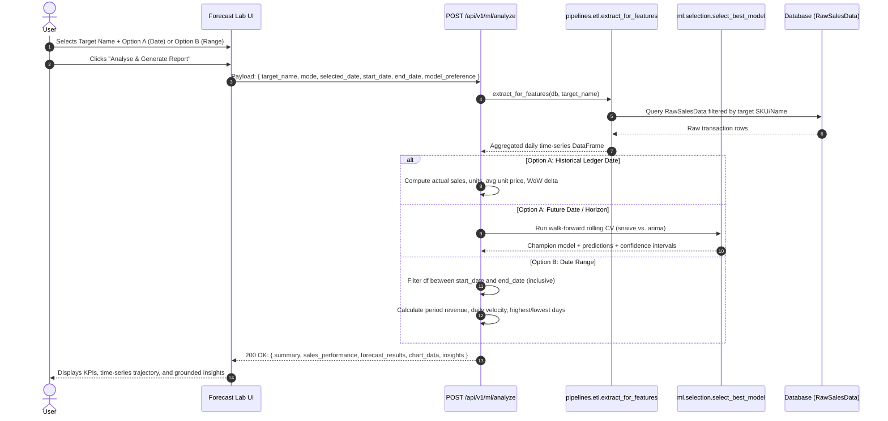
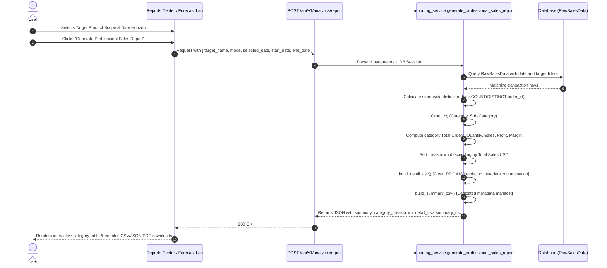

# Sales Intelligence Platform
# System Architecture Document

**Version:** 2.0  
**Planning Year:** 2026  
**Status:** Verified & Synchronized Architecture  
**Architecture Style:** Modular Monolith (FastAPI + Next.js 14 App Router)

---

## 1. System Overview

The Sales Intelligence Platform is structured as a decoupled, modular full-stack web application. It combines high-performance asynchronous Python backend APIs with an interactive React/Next.js frontend.

```mermaid
flowchart TD
    subgraph Client["Next.js 14 Frontend (Port 3000)"]
        UI_Overview["Overview Dashboard (/)"]
        UI_Analytics["Sales Analytics (/analytics)"]
        UI_Forecast["Forecast Lab (/forecast)"]
        UI_Reports["Reports & Export Center (/reports)"]
        UI_Anomalies["Anomaly Center (/anomalies)"]
        UI_Scenarios["Scenario Lab (/scenarios)"]
        UI_Health["Model Health & Prediction History (/model-health)"]
        UI_Gemini["Gemini Pro AI (/gemini)"]
        UI_Data["Data Ingestion & Preview (/data)"]
        UI_Profile["User Profile & Workspace (/profile)"]
        AxiosClient["Axios API Client (lib/api.ts)"]
    end

    subgraph API["FastAPI Application (Port 8000)"]
        Router_Auth["Auth Endpoints (/api/v1/auth)"]
        Router_Users["Users Endpoints (/api/v1/users)"]
        Router_Data["Data Endpoints (/api/v1/data)"]
        Router_ML["ML Endpoints (/api/v1/ml)"]
        Router_Analytics["Analytics Endpoints (/api/v1/analytics)"]
    end

    subgraph CoreServices["Business Logic & Domain Layer"]
        Service_ETL["ETL & Validation (app.data.validation, app.pipelines.etl)"]
        Service_Analytics["Analytics & Trends Engine (app.services.analytics_service)"]
        Service_Report["Professional Reporting Engine (app.services.reporting_service)"]
        Service_ML["Walk-Forward Engine (app.ml.selection, arima, baseline)"]
        Service_Anomaly["Dynamic Z-Score Detection (app.ml.anomaly)"]
        Service_Gemini["Google Gemini Pro (app.services.gemini_service)"]
    end

    subgraph Storage["Persistence & Storage Layer"]
        DB[(PostgreSQL / SQLite Development DB)]
        Uploads["Uploads Directory (uploads/)"]
    end

    UI_Overview --> AxiosClient
    UI_Analytics --> AxiosClient
    UI_Forecast --> AxiosClient
    UI_Reports --> AxiosClient
    UI_Anomalies --> AxiosClient
    UI_Scenarios --> AxiosClient
    UI_Health --> AxiosClient
    UI_Gemini --> AxiosClient
    UI_Data --> AxiosClient
    UI_Profile --> AxiosClient

    AxiosClient --> Router_Auth
    AxiosClient --> Router_Users
    AxiosClient --> Router_Data
    AxiosClient --> Router_ML
    AxiosClient --> Router_Analytics

    Router_Data --> Service_ETL
    Router_Analytics --> Service_Analytics
    Router_Analytics --> Service_Report
    Router_Analytics --> Service_Anomaly
    Router_Analytics --> Service_Gemini
    Router_ML --> Service_ML

    Service_ETL --> DB
    Service_Analytics --> DB
    Service_Report --> DB
    Service_ML --> DB
    Service_Anomaly --> DB
    Service_ETL --> Uploads
```


    Router_Analytics --> Service_Report
    Router_Analytics --> Service_Anomaly
    Router_Analytics --> Service_Gemini

    Service_ETL --> DB
    Service_ETL --> Uploads
    Service_Report --> DB
    Service_ML --> DB
    Service_Anomaly --> DB
```

---

## 2. Frontend Architecture (Next.js 14 App Router)

### 2.1 File & Route Structure
The frontend is built with React 18, Next.js 14 (App Router), TypeScript, and Tailwind CSS.
```text
frontend/
├── app/
│   ├── page.tsx               # Overview dashboard (Live revenue, SKUs, model accuracy)
│   ├── forecast/page.tsx      # Forecast Lab (Target Name, Option A/B, walk-forward ML)
│   ├── reports/page.tsx       # Reports & Export Center (Professional Sales Summary)
│   ├── anomalies/page.tsx     # Anomaly Center (Rolling Z-score inspection)
│   ├── scenarios/page.tsx     # Scenario Simulation Lab (Price/discount what-if)
│   ├── inventory/page.tsx     # Inventory Intelligence (Velocity, days of supply)
│   ├── model-health/page.tsx  # Model Health & Drift Monitoring
│   ├── gemini/page.tsx        # Gemini Pro Sales Advisor (/copilot backwards alias)
│   ├── data/page.tsx          # Data Ingestion & Ledger Management
│   ├── login/page.tsx         # Account authentication & active session display
│   ├── layout.tsx             # Root layout with Sidebar and Auth/Query providers
│   ├── providers.tsx          # QueryClientProvider and AuthProvider singleton
│   └── globals.css            # Dark theme styles and Tailwind directives
├── components/
│   ├── layout/Sidebar.tsx     # Main application sidebar with active route tracking
│   └── charts/ForecastChart.tsx # Dynamic Recharts time-series visualization
├── hooks/
│   └── useAuth.ts             # Authentication state, login, logout, bearer synchronization
└── lib/
    └── api.ts                 # Axios HTTP client with interceptors and auth headers
```

### 2.2 Component Responsibilities
- **`ForecastLabPage` ([`frontend/app/forecast/page.tsx`](file:///c:/Users/EMAAN/OneDrive/Documents/GitHub/sales-prediction-dashboards/frontend/app/forecast/page.tsx))**:
  - Manages Target Name selection with searchable autocomplete dropdown.
  - Controls date horizon toggles: Option A (Selected Date) and Option B (Date Range).
  - Handles Model Engine preferences (`auto`, `arima`, `baseline`).
  - Renders time-series chart via `ForecastChart` and business telemetry cards.
  - Provides quick action triggers: `"Generate Professional Sales Report"` and `"Export Professional Report (.csv)"`.
- **`ReportsPage` ([`frontend/app/reports/page.tsx`](file:///c:/Users/EMAAN/OneDrive/Documents/GitHub/sales-prediction-dashboards/frontend/app/reports/page.tsx))**:
  - Configures product scope and date horizon parameters matching Forecast Lab.
  - Parses deep-link query parameters (`?mode=...&selected_date=...`) when referred from Forecast Lab.
  - Renders interactive commercial performance grid with column sorting and client search.
  - Manages file downloads: Detail CSV (`professional_sales_summary_YYYY-MM-DD.csv`), Summary CSV, and JSON.
  - Supports browser Print-to-PDF via dedicated `@media print` layout rules.

---

## 3. Backend Architecture (FastAPI & Services)

### 3.1 Directory & Module Layout
```text
backend/
├── app/
│   ├── api/
│   │   ├── deps.py                    # get_db session dependency & get_current_user
│   │   └── v1/
│   │       ├── api.py                 # APIRouter aggregator mounting v1 routers
│   │       └── endpoints/
│   │           ├── auth.py            # User registration, login, JWT token generation
│   │           ├── data.py            # Upload, products catalog, cleanup, deduplication
│   │           ├── ml.py              # Empirical ledger analysis & model training
│   │           └── analytics.py       # Overview, anomalies, simulate, copilot, reports
│   ├── core/
│   │   ├── config.py                  # Pydantic v2 application settings and env vars
│   │   └── security.py                # Bcrypt password hashing & JWT encoding/decoding
│   ├── data/
│   │   └── validation.py              # Canonical column aliases & dataset validation
│   ├── db/
│   │   ├── base.py                    # DeclarativeBase with UUID primary keys
│   │   └── session.py                 # SQLAlchemy engine and sessionmaker
│   ├── ml/
│   │   ├── baseline.py                # Seasonal Naive (snaive) & Simple Moving Average (sma)
│   │   ├── arima.py                   # Auto-ARIMA / Statsmodels time-series model
│   │   ├── evaluation.py              # MAE, RMSE, WAPE, and forecast bias calculations
│   │   ├── selection.py               # Out-of-sample walk-forward model selector
│   │   ├── training.py                # Multi-model training pipeline
│   │   └── anomaly.py                 # Rolling Z-score anomaly detector
│   ├── models/
│   │   ├── data.py                    # RawSalesData model with order, category & profit
│   │   ├── tenant.py                  # User and Tenant multi-tenant models
│   │   └── forecast.py                # Forecast and ModelRun persistence
│   ├── pipelines/
│   │   └── etl.py                     # process_upload and extract_for_features
│   ├── schemas/                       # Pydantic schemas for auth, data, ml, analytics
│   ├── services/
│   │   ├── reporting_service.py       # Professional Sales Summary Reporting Engine
│   │   ├── gemini_service.py          # Google Gemini Pro sales advisor service
│   │   └── simulation.py              # Business scenario price/discount simulator
│   └── main.py                        # FastAPI entry point, CORS, SQLite auto-migrations
├── alembic/                           # Alembic database migrations
├── tests/                             # Automated test suite (Pytest)
└── requirements.txt                   # Production Python dependencies
```

---

## 4. End-to-End Workflow & Request Flows

### 4.1 Target Name & Product Selection Flow
1. **Frontend**: On mount, `useQuery(['available-products'])` issues `GET /api/v1/data/products`.
2. **Backend**: `get_available_products()` queries `RawSalesData`, groups by `COALESCE(product_name, sku)` and `sku`, builds unambiguous display labels, and calculates date coverage (`min_date`, `max_date`).
3. **Frontend**: Populates the Target Name dropdown. When a user selects a product, `targetName` and `selectedSku` state variables update; date bounds are automatically aligned with the product's coverage.

### 4.2 Forecast Lab Analysis Request Flow (Option A & Option B)


### 4.3 Professional Sales Summary Report Pipeline


### 4.4 CSV Download Flow
1. User clicks **"Download Detail CSV"** in Reports Center or **"Export Professional Report"** in Forecast Lab.
2. The browser creates an in-memory `Blob` from `detail_csv` with MIME type `text/csv;charset=utf-8;`.
3. Creates a virtual download link with filename `professional_sales_summary_YYYY-MM-DD.csv` and triggers the browser download.
4. Alternatively, calling `GET /api/v1/analytics/report/csv?type=detail` streams the raw CSV file directly with `Content-Disposition: attachment; filename="professional_sales_summary_YYYY-MM-DD.csv"`.

---

## 5. Database Architecture & Schema Evolution

### 5.1 Tables & Models
- **`raw_sales_data` ([`backend/app/models/data.py`](file:///c:/Users/EMAAN/OneDrive/Documents/GitHub/sales-prediction-dashboards/backend/app/models/data.py))**:
  - `id`: UUID Primary Key (`BaseModel`).
  - `date`: `Date`, indexed.
  - `order_id`: `String(100)`, indexed.
  - `sku`: `String(100)`, indexed.
  - `product_name`: `String(255)`, indexed.
  - `category`: `String(100)`, indexed.
  - `sub_category`: `String(100)`, indexed.
  - `units_sold`: `Integer`.
  - `price`: `Numeric(10, 2)`.
  - `total_sales`: `Numeric(12, 2)`.
  - `profit`: `Numeric(12, 2)`.
  - `discount_pct`: `Numeric(5, 2)`.
  - `available_stock`: `Integer`.
  - `status`: `String(50)`.
- **`users` & `tenants` ([`backend/app/models/tenant.py`](file:///c:/Users/EMAAN/OneDrive/Documents/GitHub/sales-prediction-dashboards/backend/app/models/tenant.py))**: User authentication and organization tenancy.
- **`model_runs` & `forecasts` ([`backend/app/models/forecast.py`](file:///c:/Users/EMAAN/OneDrive/Documents/GitHub/sales-prediction-dashboards/backend/app/models/forecast.py))**: Out-of-sample evaluation metrics (MAE, RMSE, WAPE) and projected points with confidence intervals.

### 5.2 SQLite Development Auto-Migration
To avoid breaking local development environments when database columns are added, [`backend/app/main.py`](file:///c:/Users/EMAAN/OneDrive/Documents/GitHub/sales-prediction-dashboards/backend/app/main.py) automatically checks table schemas on startup:
```python
if str(engine.url).startswith("sqlite"):
    with engine.connect() as conn:
        cursor_sales = conn.exec_driver_sql("PRAGMA table_info(raw_sales_data)")
        sales_cols = [row[1] for row in cursor_sales.fetchall()]
        for col_name, col_type in [
            ("order_id", "VARCHAR(100)"),
            ("category", "VARCHAR(100)"),
            ("sub_category", "VARCHAR(100)"),
            ("total_sales", "FLOAT"),
            ("profit", "FLOAT"),
        ]:
            if col_name not in sales_cols:
                conn.exec_driver_sql(f"ALTER TABLE raw_sales_data ADD COLUMN {col_name} {col_type}")
        conn.commit()
```

---

## 6. Security, Multi-Tenancy & Error Boundaries

1. **Authentication & Authorization**: Protected endpoints require a valid JWT Bearer token issued by `POST /api/v1/auth/login`. Token expiration is set to 60 minutes (`ACCESS_TOKEN_EXPIRE_MINUTES`).
2. **Tenant Isolation**: When querying `raw_sales_data` in multi-tenant mode, requests are scoped by `tenant_id`.
3. **Data Integrity & Non-Fabrication**:
   - The platform never fabricates numbers or returns placeholder approximations.
   - If optional fields (`profit`, `category`, `order_id`) are absent from a dataset, the system safely marks them as `"N/A"` with descriptive schema notes.
   - Distinct order counts are derived strictly from distinct `order_id` values.
4. **Resilience & Fallback**:
   - Gemini Pro advisor checks model connectivity and returns diagnostic evidence if the upstream API fails.
   - Date range validation prevents reversed dates (`startDate > endDate`).
   - Empty state UI banners inform users when imported datasets have zero records.

---

**End of System Architecture Document**
