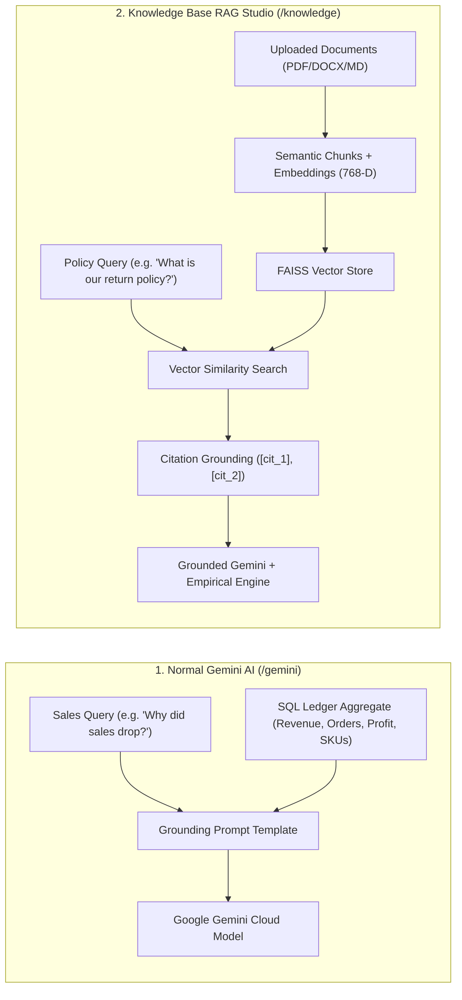

# Sales Intelligence Platform
# System Architecture Document

**Version:** 3.0  
**Planning Year:** 2026  
**Last Synchronized:** October 30, 2026  
**Architecture Style:** Modular Monolith with Multi-Tenant SaaS, Universal Data Cleaning, and Dual-Layer RAG

---

## 1. System Overview

The Sales Intelligence Platform is an enterprise-grade AI-powered business intelligence application that transforms historical retail transaction ledgers into forward demand trajectories, detects operational anomalies, provides explainable generative sales intelligence, performs 20-step multi-format data cleaning, and executes retrieval-augmented generation (RAG) over corporate policies.

```mermaid
flowchart TD
    subgraph Client["Next.js 14 Frontend (Port 3000)"]
        UI_Welcome["Animated Welcome Page (/)"]
        UI_Auth["Authentication (/login)"]
        UI_Overview["Overview Dashboard (/dashboard)"]
        UI_Cleaning["Data Cleaning Studio (/cleaning)"]
        UI_Knowledge["Knowledge Base RAG (/knowledge)"]
        UI_Analytics["Sales Analytics (/analytics)"]
        UI_Forecast["Forecast Lab (/forecast)"]
        UI_Reports["Reports & Export Center (/reports)"]
        UI_Anomalies["Anomaly Center (/anomalies)"]
        UI_Scenarios["Scenario Lab (/scenarios)"]
        UI_Inventory["Inventory Intelligence (/inventory)"]
        UI_Health["Model Health (/model-health)"]
        UI_Gemini["Gemini AI Advisor (/gemini)"]
        UI_Billing["Subscription & Plans (/billing)"]
        UI_Audit["Audit Logs (/audit)"]
        UI_Data["Data Ingestion (/data)"]
        AxiosClient["Axios API Client (lib/api.ts)"]
    end

    subgraph API["FastAPI Application (Port 8000)"]
        Router_Auth["Auth Endpoints (/api/v1/auth)"]
        Router_Orgs["Organizations (/api/v1/organizations)"]
        Router_Billing["Billing & Stripe (/api/v1/billing)"]
        Router_Cleaning["Data Cleaning (/api/v1/cleaning)"]
        Router_RAG["RAG & Knowledge (/api/v1/rag)"]
        Router_Data["Data Ingestion (/api/v1/data)"]
        Router_ML["ML & Forecasting (/api/v1/ml)"]
        Router_Analytics["Analytics & Gemini (/api/v1/analytics)"]
    end

    subgraph CoreServices["Business Logic & Domain Engines"]
        Engine_Cleaning["20-Step Cleaning Pipeline & Exporter"]
        Engine_RAG["RAG Engine (FAISS + Embedding + Citation Generator)"]
        Engine_ML["Walk-Forward Engine (Auto-ARIMA & Seasonal Naive)"]
        Engine_Analytics["Ledger Aggregation & Non-Fabrication Analytics"]
        Engine_Gemini["Direct Gemini Sales Intelligence (gemini_service)"]
        Engine_Billing["Subscription Quotas & Stripe Webhooks"]
        Engine_Audit["Forensic Audit Logger"]
    end

    subgraph Storage["Persistence & Vector Layer"]
        DB[(PostgreSQL / SQLite Development DB)]
        FAISS_Store["Dual-Layer FAISS Vector Indices (uploads/tenants/*/vector_store)"]
        Export_Cache["On-Disk Export Cache (uploads/tenants/*/exports)"]
        Document_Store["Document Store (uploads/tenants/*/rag_documents)"]
    end

    Client --> AxiosClient
    AxiosClient --> Router_Auth
    AxiosClient --> Router_Orgs
    AxiosClient --> Router_Billing
    AxiosClient --> Router_Cleaning
    AxiosClient --> Router_RAG
    AxiosClient --> Router_Data
    AxiosClient --> Router_ML
    AxiosClient --> Router_Analytics

    Router_Cleaning --> Engine_Cleaning
    Router_RAG --> Engine_RAG
    Router_ML --> Engine_ML
    Router_Analytics --> Engine_Analytics
    Router_Analytics --> Engine_Gemini
    Router_Billing --> Engine_Billing
    Router_Orgs --> Engine_Audit

    Engine_Cleaning --> DB
    Engine_Cleaning --> Export_Cache
    Engine_RAG --> DB
    Engine_RAG --> FAISS_Store
    Engine_RAG --> Document_Store
    Engine_ML --> DB
    Engine_Analytics --> DB
    Engine_Billing --> DB
    Engine_Audit --> DB
```



---

## 2. Frontend Architecture (Next.js 14 App Router)

### 2.1 File & Route Structure
```text
frontend/
├── app/
│   ├── page.tsx               # Animated welcome flow with 7-stage telemetry sequence
│   ├── login/page.tsx         # Dedicated Sign In & Create Account tabs with session cards
│   ├── dashboard/page.tsx     # Overview dashboard (Live revenue, SKUs, model accuracy)
│   ├── data/page.tsx          # Data Ingestion, dataset previews, and schema mapping
│   ├── cleaning/page.tsx      # Universal Data Cleaning Studio (20-step pipeline & exports)
│   ├── knowledge/page.tsx     # Knowledge Assistant & RAG Studio (Vector search & chat)
│   ├── analytics/page.tsx     # Sales Analytics, category mix, and profit margin analysis
│   ├── forecast/page.tsx      # Forecast Lab (Target selection, Option A/B, walk-forward ML)
│   ├── anomalies/page.tsx     # Anomaly Center (Rolling Z-score anomaly detection)
│   ├── scenarios/page.tsx     # Scenario Lab (Price elasticity & discount simulations)
│   ├── inventory/page.tsx     # Inventory Intelligence (Velocity, days of supply)
│   ├── model-health/page.tsx  # Model Health, drift monitoring & walk-forward benchmarks
│   ├── gemini/page.tsx        # Direct Gemini Pro Sales Advisor
│   ├── reports/page.tsx       # Reports & Export Center (Professional Sales Summary CSV/PDF)
│   ├── billing/page.tsx       # Subscription & Plans (Stripe checkout, tier upgrade cards)
│   ├── audit/page.tsx         # Immutable forensic audit logs
│   ├── profile/page.tsx       # User profile and account preferences
│   ├── invite/accept/page.tsx # Multi-tenant invitation acceptance flow
│   ├── layout.tsx             # Root layout with Sidebar and Auth/Query providers
│   └── globals.css            # Dark theme styles and Tailwind directives
├── components/
│   ├── layout/
│   │   ├── AppShell.tsx       # Client-side route isolation guard (isolates public routes)
│   │   └── Sidebar.tsx        # Multi-tenant workspace switcher & 14-item navigation menu
│   ├── dashboard/             # Ingestion preview, KPI stat cards, and ledger telemetry
│   └── charts/                # Dynamic Recharts time-series visualizations
├── hooks/
│   └── useAuth.ts             # Auth state, login/register, multi-tenant workspace switching
└── lib/
    └── api.ts                 # Axios HTTP client with tenant isolation headers
```

---

## 3. Backend Architecture (FastAPI & Services)

### 3.1 Modular Router Structure
```text
backend/app/api/v1/endpoints/
├── auth.py            # User registration, login, JWT token issuance, password resets
├── organizations.py   # Multi-tenant organization workspaces, memberships, role management
├── billing.py         # Subscription tiers, Stripe checkout sessions, customer portal, webhooks
├── users.py           # User profiles, system admin operations
├── data.py            # Upload, products catalog, cleanup, deduplication, SKU metadata
├── cleaning.py        # 20-step pipeline, structural profiling, high-speed exports, audit reports
├── rag.py             # Knowledge document ingestion, FAISS vector search, grounded chat
├── ml.py              # Out-of-sample walk-forward model training and continuous health logging
└── analytics.py       # Overview KPIs, anomalies, scenario simulation, Gemini advisor, reports
```

### 3.2 Core Service & Engine Layers
1. **Universal Data Cleaning Pipeline (`app/services/cleaning/`)**:
   - `profiler.py`: Formats, row/column counts, missing value matrices, memory footprints.
   - `pipeline_engine.py`: 20 discrete cleaning steps with provenance tracking.
   - `exporter.py`: High-speed multi-format conversion (`csv`, `xlsx`, `parquet`, `json`, `tsv`) using `xlsxwriter` and PyArrow with on-disk caching.
   - `report_generator.py`: PDF executive audit reports and multi-sheet formatted Excel workbooks.
2. **Retrieval-Augmented Generation (`app/services/rag/`)**:
   - `document_service.py`: Format validation, token counting, semantic chunking, and file ingestion.
   - `embedding_service.py`: 768-D vector embeddings via Gemini `text-embedding-004` and deterministic pseudo-semantic fallback projection.
   - `vector_store.py`: Accelerated FAISS Inner Product search on normalized unit vectors with SQLite / PostgreSQL metadata fallback.
   - `retrieval_service.py`: Multi-tenant semantic retrieval with adaptive threshold calibration for fallback embeddings.
   - `rag_service.py`: Intent classification, citation assembly (`[cit_X]`), grounded Gemini synthesis, and local empirical answer generation.
   - `sample_knowledge.py`: 1-click seeding of standard enterprise sales playbooks, return policies, and product specifications.
3. **Machine Learning & Time-Series (`app/ml/`)**:
   - `selection.py`: Walk-forward cross-validation comparing Seasonal Naive vs. Auto-ARIMA.
   - `evaluation.py`: Mathematical computation of MAE, RMSE, WAPE, and forecast bias.
   - `drift.py`: Continuous drift evaluation across sequential model evaluation runs.
   - `anomaly.py`: Rolling dynamic Z-score anomaly detector.
4. **Sales Intelligence & Reporting (`app/services/`)**:
   - `reporting_service.py`: Strict non-fabrication engine compiling `professional_sales_summary_YYYY-MM-DD.csv`.
   - `gemini_service.py`: Direct Google Gemini sales consultant grounded in live database KPIs.
   - `audit_service.py`: Non-repudiation forensic audit logging recording all state changes.

---

## 4. Distinct AI Architecture: Normal Gemini vs. RAG + Gemini

The platform houses two distinct AI capabilities engineered for different business workflows:



---

## 5. Multi-Tenant Security & Storage Topology

### 5.1 Storage Directory Structure
All user data and vector indices are strictly isolated by tenant UUID:
```text
uploads/
└── tenants/
    └── <tenant_uuid>/
        ├── raw/                # Original uploaded customer datasets
        ├── cleaning_workspace/ # Working copies and versioned datasets
        ├── exports/            # Cached high-speed export files (.csv, .xlsx, .parquet, .json, .tsv)
        ├── rag_documents/      # Ingested knowledge documents (PDF, DOCX, MD)
        └── vector_store/       # FAISS index (index.faiss) and chunk ID mappings (mappings.json)
```

### 5.2 Multi-Tenant Role Hierarchy
- **`OWNER`**: Organization owner; manages billing, deletion, workspaces, and all member roles.
- **`ADMIN`**: Workspace admin; invites team members, triggers pipeline jobs, adjusts member roles.
- **`ANALYST`**: Data analyst; uploads datasets, executes data cleaning, trains ML models, accesses exports.
- **`VIEWER`**: Read-only user; views telemetry dashboards, reads reports, submits RAG chat inquiries.

---

**End of System Architecture Document**
