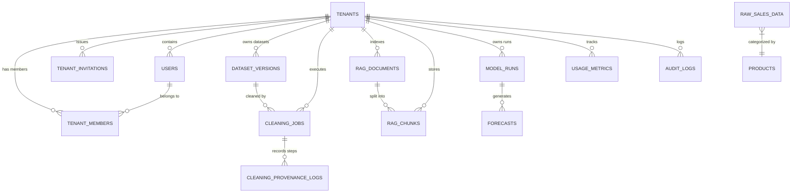

# Sales Intelligence Platform
# Database Architecture & Schema Specification

**Version:** 3.0  
**Planning Year:** 2026  
**Last Synchronized:** October 30, 2026  
**Engines:** SQLite 3 (Local Development) / PostgreSQL 15 (Docker) / Neon Serverless PostgreSQL (Production Cloud)  
**ORM:** SQLAlchemy 2.0  
**Migration Engine:** Alembic + SQLAlchemy Metadata Engine + SQLite Startup Auto-Migrator

---

## 1. Database Architecture Overview

The database layer balances local zero-configuration developer experience with multi-tenant PostgreSQL containerization and serverless cloud deployment.

- **Development Engine**: SQLite (`backend/sql_app.db`) managed via `sqlite:////sql_app.db`.
- **Production Cloud Engine**: Neon Serverless PostgreSQL (`postgresql://...neon.tech/neondb?sslmode=require`) equipped with PgBouncer connection pooling, `pool_pre_ping=True`, and `pool_recycle=300`.
- **Container Engine**: PostgreSQL 15 (`postgresql://postgres:password@db:5432/sales_intel`).
- **Base Model Standard**: All domain entities inherit from `BaseModel` ([`backend/app/db/base.py`](file:///c:/Users/EMAAN/AI-Powered%20Sales%20Intelligence%20%26%20Forecasting%20Platform/backend/app/db/base.py)), featuring:
  - `id`: `UUID(as_uuid=True)` / `VARCHAR(36)` primary key.
  - `created_at`: `DATETIME` with UTC timezone, initialized via `func.now()`.
  - `updated_at`: `DATETIME` with UTC timezone, updated via `onupdate=func.now()`.

---

## 2. Table Specifications

### 2.1 Multi-Tenant SaaS Entities

#### `tenants`
Tracks isolated customer organizations and workspace boundaries.
| Column | Type | Constraints | Description |
| :--- | :--- | :--- | :--- |
| `id` | `UUID` | PK, Not Null | Unique organization identifier |
| `name` | `VARCHAR(255)` | Not Null | Display name of the organization |
| `subdomain` | `VARCHAR(100)` | Unique, Nullable | Subdomain alias for workspace |
| `subscription_tier` | `VARCHAR(50)` | Default `'FREE'` | `'FREE'`, `'STARTER'`, `'PROFESSIONAL'`, `'ENTERPRISE'` |
| `subscription_status`| `VARCHAR(50)` | Default `'ACTIVE'` | `'ACTIVE'`, `'TRIALING'`, `'PAST_DUE'`, `'CANCELED'` |
| `owner_id` | `UUID` | FK `users.id`, Nullable | Primary account owner |
| `created_at` | `DATETIME` | UTC Timestamp | Creation timestamp |
| `updated_at` | `DATETIME` | UTC Timestamp | Modification timestamp |

#### `tenant_members`
Enforces Role-Based Access Control (RBAC) membership within workspaces.
| Column | Type | Constraints | Description |
| :--- | :--- | :--- | :--- |
| `id` | `UUID` | PK, Not Null | Membership record ID |
| `tenant_id` | `UUID` | FK `tenants.id`, Not Null | Target organization workspace |
| `user_id` | `UUID` | FK `users.id`, Not Null | Member user ID |
| `role` | `VARCHAR(50)` | Default `'MEMBER'` | `'OWNER'`, `'ADMIN'`, `'ANALYST'`, `'VIEWER'` |
| `created_at` | `DATETIME` | UTC Timestamp | Membership joined date |

#### `tenant_invitations`
Handles email-based onboarding and member invitation tokens.
| Column | Type | Constraints | Description |
| :--- | :--- | :--- | :--- |
| `id` | `UUID` | PK, Not Null | Invitation record ID |
| `tenant_id` | `UUID` | FK `tenants.id`, Not Null | Inviting organization |
| `email` | `VARCHAR(255)` | Not Null | Recipient email address |
| `role` | `VARCHAR(50)` | Default `'VIEWER'` | Role assigned upon acceptance |
| `token_hash` | `VARCHAR(64)` | Not Null, Index | SHA-256 hash of the invitation token |
| `status` | `VARCHAR(50)` | Default `'PENDING'` | `'PENDING'`, `'ACCEPTED'`, `'REVOKED'`, `'EXPIRED'` |
| `expires_at` | `DATETIME` | Not Null | Expiration timestamp |
| `accepted_at` | `DATETIME` | Nullable | Token acceptance timestamp |

---

### 2.2 Universal Data Cleaning Entities

#### `dataset_versions`
Tracks versioned customer datasets, structural profiling metadata, and cleaning status.
| Column | Type | Constraints | Description |
| :--- | :--- | :--- | :--- |
| `id` | `UUID` | PK, Not Null | Version identifier |
| `tenant_id` | `UUID` | FK `tenants.id`, Not Null | Owning tenant workspace |
| `original_filename`| `VARCHAR(255)` | Not Null | User uploaded filename |
| `file_format` | `VARCHAR(50)` | Not Null | Format (`csv`, `xlsx`, `json`, `parquet`, etc.) |
| `row_count` | `INTEGER` | Default 0 | Row count |
| `column_count` | `INTEGER` | Default 0 | Column count |
| `file_size_bytes` | `INTEGER` | Not Null | Physical file size in bytes |
| `checksum_sha256` | `VARCHAR(64)` | Not Null | SHA-256 integrity hash |
| `is_cleaned` | `BOOLEAN` | Default `False` | Whether cleaning pipeline executed |
| `metadata_json` | `TEXT` | Nullable | Profiling matrices, quality scorecard, latest job ID |

#### `cleaning_jobs`
Executes and records 20-step pipeline execution jobs.
| Column | Type | Constraints | Description |
| :--- | :--- | :--- | :--- |
| `id` | `UUID` | PK, Not Null | Cleaning job identifier |
| `tenant_id` | `UUID` | FK `tenants.id`, Not Null | Tenant workspace |
| `dataset_version_id`| `UUID` | FK `dataset_versions.id` | Source dataset version |
| `status` | `VARCHAR(50)` | Default `'PENDING'` | `'PENDING'`, `'PROCESSING'`, `'COMPLETED'`, `'FAILED'` |
| `total_steps` | `INTEGER` | Default 20 | Pipeline step count |
| `completed_steps`| `INTEGER` | Default 0 | Steps completed |
| `pipeline_config` | `TEXT` | Nullable | JSON configuration of user options |
| `results_summary` | `TEXT` | Nullable | Before/after row counts, null counts, execution logs |

#### `cleaning_provenance_logs`
Fine-grained step-by-step audit provenance for every transformation step.
| Column | Type | Constraints | Description |
| :--- | :--- | :--- | :--- |
| `id` | `UUID` | PK, Not Null | Log record ID |
| `job_id` | `UUID` | FK `cleaning_jobs.id` | Parent cleaning job |
| `step_number` | `INTEGER` | Not Null | Step index (1 to 20) |
| `step_name` | `VARCHAR(100)` | Not Null | Step label (e.g. `deduplication`, `imputation`) |
| `status` | `VARCHAR(50)` | Not Null | `'APPLIED'`, `'SKIPPED'`, `'FAILED'` |
| `details_json` | `TEXT` | Nullable | Transformation metadata and delta changes |

---

### 2.3 Knowledge Base & RAG Entities

#### `rag_documents`
Stores metadata and indexing lifecycle for knowledge documents.
| Column | Type | Constraints | Description |
| :--- | :--- | :--- | :--- |
| `id` | `UUID` | PK, Not Null | Document identifier |
| `tenant_id` | `UUID` | FK `tenants.id`, Not Null | Isolated tenant workspace |
| `user_id` | `UUID` | FK `users.id`, Nullable | Uploader user ID |
| `title` | `VARCHAR(255)` | Not Null | Document title |
| `original_filename`| `VARCHAR(255)` | Not Null | Original filename |
| `file_path` | `VARCHAR(500)` | Not Null | Isolated physical disk path |
| `file_size` | `INTEGER` | Not Null | File size in bytes |
| `mime_type` | `VARCHAR(100)` | Not Null | MIME type |
| `file_type` | `VARCHAR(50)` | Not Null | Extension (`pdf`, `docx`, `txt`, `md`, `json`) |
| `checksum_sha256` | `VARCHAR(64)` | Index, Not Null | Cryptographic deduplication hash |
| `status` | `VARCHAR(50)` | Default `'UPLOADED'` | `'UPLOADED'`, `'PROCESSING'`, `'INDEXED'`, `'FAILED'` |
| `total_chunks` | `INTEGER` | Default 0 | Extracted semantic chunk count |
| `error_message` | `TEXT` | Nullable | Detailed failure reason |
| `metadata_json` | `TEXT` | Nullable | Document author, section layout |

#### `rag_chunks`
Discrete semantic chunks extracted for vector similarity retrieval.
| Column | Type | Constraints | Description |
| :--- | :--- | :--- | :--- |
| `id` | `UUID` | PK, Not Null | Chunk identifier |
| `document_id` | `UUID` | FK `rag_documents.id` | Parent knowledge document |
| `tenant_id` | `UUID` | FK `tenants.id`, Not Null | Tenant workspace |
| `chunk_index` | `INTEGER` | Not Null | Sequential chunk index |
| `chunk_text` | `TEXT` | Not Null | Semantic chunk body |
| `token_count` | `INTEGER` | Default 0 | Token count |
| `embedding_json` | `TEXT` | Nullable | Serialized 768-D float vector array |
| `page_number` | `INTEGER` | Nullable | Source document page number |
| `section_title` | `VARCHAR(255)` | Nullable | Extracted markdown/header section |
| `embedding_model`| `VARCHAR(100)` | Nullable | Model name (`text-embedding-004`) |

---

### 2.4 Governance & Metering Entities

#### `usage_metrics`
Tracks tenant resource consumption against plan tier quotas.
| Column | Type | Constraints | Description |
| :--- | :--- | :--- | :--- |
| `id` | `UUID` | PK, Not Null | Usage entry ID |
| `tenant_id` | `UUID` | FK `tenants.id`, Not Null | Tenant workspace |
| `metric_type` | `VARCHAR(50)` | Not Null | `'ROWS_INGESTED'`, `'STORAGE_BYTES'`, `'MODEL_RUNS'`, `'LLM_QUERIES'` |
| `metric_value` | `FLOAT` | Not Null | Accumulated value |
| `period_start` | `DATETIME` | Not Null | Billing period start |
| `period_end` | `DATETIME` | Not Null | Billing period end |

#### `audit_logs`
Immutable forensic activity logs.
| Column | Type | Constraints | Description |
| :--- | :--- | :--- | :--- |
| `id` | `UUID` | PK, Not Null | Audit log ID |
| `tenant_id` | `UUID` | FK `tenants.id`, Not Null | Tenant workspace |
| `user_id` | `UUID` | FK `users.id`, Nullable | Performing user ID |
| `action` | `VARCHAR(100)` | Not Null | Event action (e.g. `DATASET_CLEANED`, `DOCUMENT_UPLOADED`) |
| `ip_address` | `VARCHAR(45)` | Nullable | Client IP address |
| `user_agent` | `VARCHAR(255)` | Nullable | Client user agent |
| `details_json` | `TEXT` | Nullable | Serialized action payload |

---

**End of Database Architecture Document**
