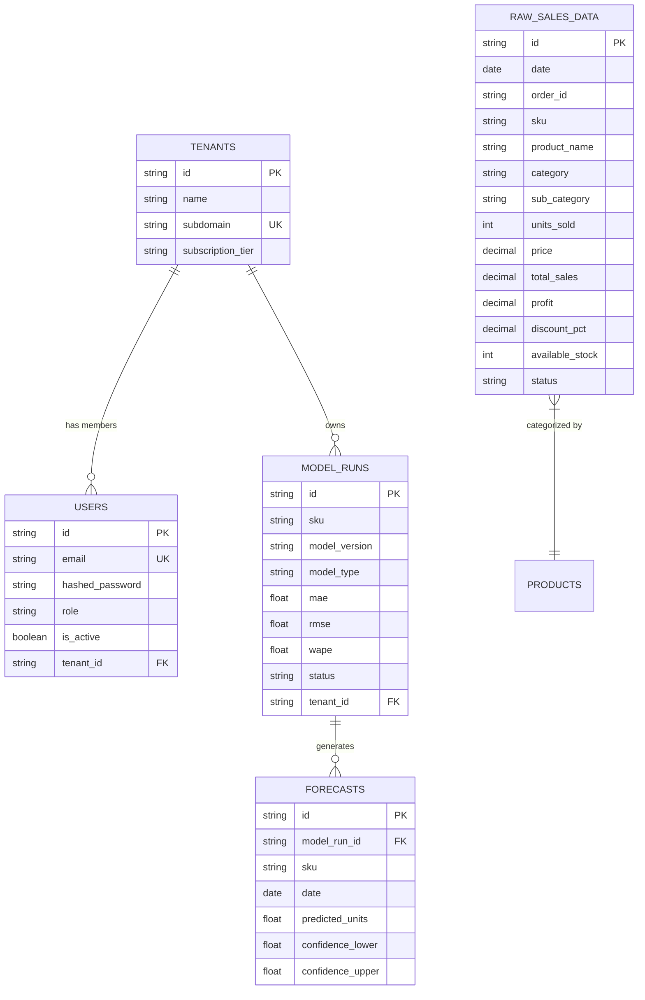

# Sales Intelligence Platform
# Database Architecture & Schema Specification

**Version:** 2.0  
**Planning Year:** 2026  
**Status:** Verified & Synchronized Specification  
**Engines:** SQLite 3 (Local Development) / PostgreSQL 15 (Production Container)  
**ORM:** SQLAlchemy 2.0  
**Migration Engine:** Alembic + SQLite Startup Auto-Migrator

---

## 1. Database Architecture Overview

The database layer balances local zero-configuration developer experience with multi-tenant PostgreSQL containerization.

- **Development Engine**: SQLite (`backend/sql_app.db`) managed via `sqlite:////sql_app.db`.
- **Production Engine**: PostgreSQL 15 (`postgresql://postgres:password@db:5432/sales_intel`).
- **Base Model Standard**: All domain entities inherit from `BaseModel` ([`backend/app/db/base.py`](file:///c:/Users/EMAAN/OneDrive/Documents/GitHub/sales-prediction-dashboards/backend/app/db/base.py)), featuring:
  - `id`: `VARCHAR(36)` UUID v4 string primary key.
  - `created_at`: `DATETIME` with UTC timezone, initialized via `func.now()`.
  - `updated_at`: `DATETIME` with UTC timezone, updated via `onupdate=func.now()`.



---

## 2. Table Schemas & Column Definitions

### 2.1 `raw_sales_data` Table
Implemented in [`backend/app/models/data.py`](file:///c:/Users/EMAAN/OneDrive/Documents/GitHub/sales-prediction-dashboards/backend/app/models/data.py). Stores full row-level transactional records.

| Column | Type | Nullable | Indexed | Default | Description |
| :--- | :--- | :--- | :--- | :--- | :--- |
| `id` | `VARCHAR(36)` | **No** | Primary Key | UUID4 | Record unique identifier. |
| `date` | `DATE` | **No** | **Yes** | None | Order/transaction date. |
| `order_id` | `VARCHAR(100)` | Yes | **Yes** | None | Customer order / basket ID. |
| `sku` | `VARCHAR(100)` | **No** | **Yes** | None | Unique merchandise product code. |
| `product_name` | `VARCHAR(255)` | Yes | **Yes** | None | Human-readable product name. |
| `category` | `VARCHAR(100)` | Yes | **Yes** | None | Top-level commercial merchandise category. |
| `sub_category` | `VARCHAR(100)` | Yes | **Yes** | None | Secondary merchandise department. |
| `units_sold` | `INTEGER` | **No** | No | None | Quantity of units sold in line item. |
| `price` | `NUMERIC(10,2)`| Yes | No | None | Unit price in USD. |
| `total_sales` | `NUMERIC(12,2)`| Yes | No | None | Total line-item sales revenue in USD. |
| `profit` | `NUMERIC(12,2)`| Yes | No | None | Total line-item profit/loss in USD. |
| `discount_pct` | `NUMERIC(5,2)` | Yes | No | `0.0` | Promotional discount percentage. |
| `available_stock`| `INTEGER` | Yes | No | `150` | Inventory on-hand level. |
| `holiday_flag` | `INTEGER` | Yes | No | `0` | Binary indicator for calendar holidays. |
| `festival_flag`| `INTEGER` | Yes | No | `0` | Binary indicator for promotional festivals. |
| `status` | `VARCHAR(50)` | Yes | No | `'PENDING'` | Ingestion status (`PENDING`, `PROCESSED`). |
| `created_at` | `DATETIME` | **No** | No | UTC now | Row creation timestamp. |
| `updated_at` | `DATETIME` | **No** | No | UTC now | Row modification timestamp. |

### 2.2 `users` & `tenants` Tables
Implemented in [`backend/app/models/tenant.py`](file:///c:/Users/EMAAN/OneDrive/Documents/GitHub/sales-prediction-dashboards/backend/app/models/tenant.py).

#### `users`
- `id` (`VARCHAR(36)`, PK)
- `email` (`VARCHAR(255)`, Unique, Indexed, Not Null)
- `hashed_password` (`VARCHAR(255)`, Not Null)
- `role` (`VARCHAR(50)`, Default `'ANALYST'`): Role-Based Access Control (`ADMIN`, `ANALYST`, `MANAGER`).
- `is_active` (`BOOLEAN`, Default `True`)
- `tenant_id` (`VARCHAR(36)`, FK `tenants.id`, Nullable)

#### `tenants`
- `id` (`VARCHAR(36)`, PK)
- `name` (`VARCHAR(255)`, Not Null)
- `subdomain` (`VARCHAR(100)`, Unique, Nullable)
- `subscription_tier` (`VARCHAR(50)`, Default `'STARTER'`)

### 2.3 `model_runs` & `forecasts` Tables
Implemented in [`backend/app/models/forecast.py`](file:///c:/Users/EMAAN/OneDrive/Documents/GitHub/sales-prediction-dashboards/backend/app/models/forecast.py).

#### `model_runs`
- `id` (`VARCHAR(36)`, PK)
- `sku` (`VARCHAR(100)`, Indexed, Nullable)
- `model_version` (`VARCHAR(100)`, Default `'v1.0'`)
- `model_type` (`VARCHAR(50)`): Model identifier (`snaive`, `sma`, `arima`, `hybrid`).
- `mae` (`FLOAT`, Nullable): Mean Absolute Error.
- `rmse` (`FLOAT`, Nullable): Root Mean Squared Error.
- `wape` (`FLOAT`, Nullable): Weighted Absolute Percentage Error.
- `status` (`VARCHAR(50)`, Default `'COMPLETED'`)
- `tenant_id` (`VARCHAR(36)`, Nullable)

#### `forecasts`
- `id` (`VARCHAR(36)`, PK)
- `model_run_id` (`VARCHAR(36)`, FK `model_runs.id`, Indexed)
- `sku` (`VARCHAR(100)`, Indexed)
- `date` (`DATE`, Indexed, Not Null)
- `predicted_units` (`FLOAT`, Not Null)
- `confidence_lower` (`FLOAT`, Nullable): 80% or 95% lower prediction bound.
- `confidence_upper` (`FLOAT`, Nullable): 80% or 95% upper prediction bound.

---

## 3. SQLite Development Auto-Migration

To ensure smooth local execution when new columns are added without requiring manual SQLite migration scripts, [`backend/app/main.py`](file:///c:/Users/EMAAN/OneDrive/Documents/GitHub/sales-prediction-dashboards/backend/app/main.py) executes a non-destructive startup introspection:

1. Connects to the database and checks `PRAGMA table_info(raw_sales_data)`.
2. Inspects existing column names.
3. If `order_id`, `category`, `sub_category`, `total_sales`, or `profit` are absent, executes:
   ```sql
   ALTER TABLE raw_sales_data ADD COLUMN order_id VARCHAR(100);
   ALTER TABLE raw_sales_data ADD COLUMN category VARCHAR(100);
   ALTER TABLE raw_sales_data ADD COLUMN sub_category VARCHAR(100);
   ALTER TABLE raw_sales_data ADD COLUMN total_sales FLOAT;
   ALTER TABLE raw_sales_data ADD COLUMN profit FLOAT;
   ```
4. Commits changes cleanly to SQLite without corrupting existing records.

---

## 4. Production PostgreSQL & Alembic Migrations

Production container deployments utilize Alembic:
- Configuration: [`backend/alembic.ini`](file:///c:/Users/EMAAN/OneDrive/Documents/GitHub/sales-prediction-dashboards/backend/alembic.ini).
- Environment: [`backend/alembic/env.py`](file:///c:/Users/EMAAN/OneDrive/Documents/GitHub/sales-prediction-dashboards/backend/alembic/env.py).
- Generating new migrations:
  ```bash
  cd backend
  alembic revision --autogenerate -m "Add commercial reporting columns"
  alembic upgrade head
  ```

---

## 5. Deduplication & Transactional Integrity

- **Clean Duplicates Endpoint** ([`POST /api/v1/data/clean-duplicates`](file:///c:/Users/EMAAN/OneDrive/Documents/GitHub/sales-prediction-dashboards/backend/app/api/v1/endpoints/data.py)):
  - Evaluates uniqueness across: `['date', 'sku', 'units_sold', 'order_id', 'product_name', 'total_sales']`.
  - Preserves legitimate multiple transactions on the same calendar day for different orders.
- **Upload Overwrite Standard**: `POST /api/v1/data/upload?replace=true` safely deletes prior raw transactions, model runs, and forecasts in a single atomic database transaction before inserting newly uploaded records.

---

**End of Database Architecture & Schema Specification**
