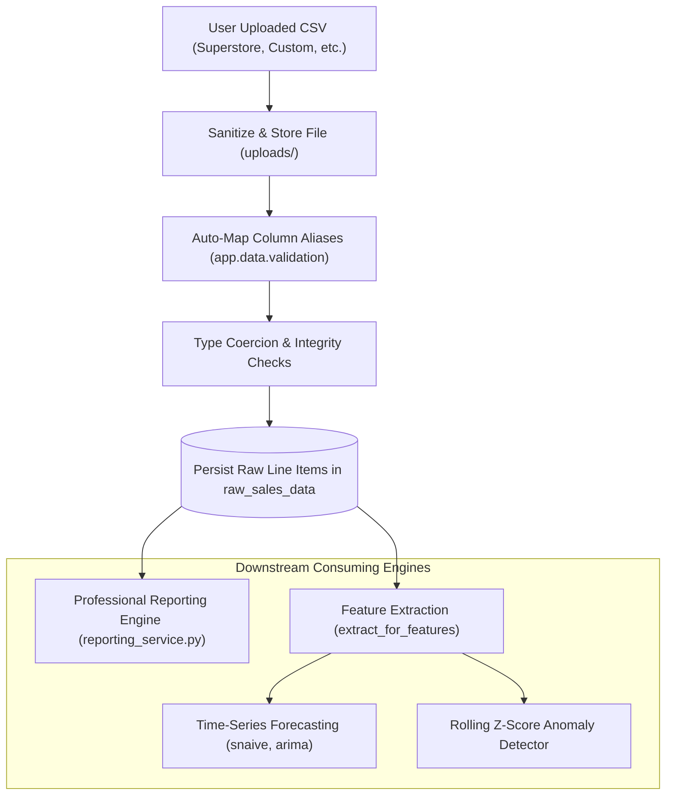

# Sales Intelligence Platform
# Data Pipeline & ETL Architecture

**Document:** DATA_PIPELINE.md  
**Version:** 2.0  
**Planning Year:** 2026  
**Status:** Verified & Synchronized Specification  
**Components:** Ingestion, Schema Normalization, Validation, Feature Extraction, and Reporting Feed

---

## 1. Pipeline Overview

The Data Pipeline orchestrates raw CSV ingestion, schema validation, data cleaning, line-item persistence, and feature extraction for machine learning and commercial reporting.

---

## 2. Ingestion Pipeline ([`backend/app/pipelines/etl.py`](file:///c:/Users/EMAAN/OneDrive/Documents/GitHub/sales-prediction-dashboards/backend/app/pipelines/etl.py))

### 2.1 File Encoding & Ingestion Safety
- **Encodings Checked**: `utf-8`, `utf-8-sig`, `latin1`, `cp1252`, `iso-8859-1`. Falls back to `encoding_errors='replace'`.
- **Sanitized Filename**: Uses UUID prefix (`uuid.uuid4().hex`) to prevent path traversal attacks.
- **Upload Overwrite Guarantee**: When `replace=True` (default), the pipeline deletes prior records from `raw_sales_data`, `model_runs`, and `forecasts` in an atomic database transaction before loading the new records, eliminating duplicate data accumulation across uploads.

---

## 3. Column Normalization & Canonical Aliases ([`backend/app/data/validation.py`](file:///c:/Users/EMAAN/OneDrive/Documents/GitHub/sales-prediction-dashboards/backend/app/data/validation.py))

Incoming headers are normalized by lowercasing, stripping punctuation, and mapping variants:

| Canonical Field | Recognized Aliases | Default / Fallback Rule |
| :--- | :--- | :--- |
| `date` | `date`, `order date`, `order_date`, `transaction_date`, `sales_date`, `time` | **Mandatory**. Parsing errors raise validation error. |
| `order_id` | `order id`, `order_id`, `orderid`, `transaction id`, `invoice id`, `invoice_no` | Optional. Stripped of string whitespace. If absent, set to `NaN`. |
| `sku` | `sku`, `product id`, `product_id`, `productid`, `item code`, `item_id` | **Mandatory**. |
| `product_name` | `product name`, `product_name`, `productname`, `item name`, `title`, `description` | Optional. Defaults to `sku` value if omitted. |
| `category` | `category`, `product category`, `department`, `dept` | Optional. Defaults to `NaN` if omitted. |
| `sub_category` | `sub-category`, `subcategory`, `sub category`, `product sub category` | Optional. Disentangled from `sku` to prevent alias collision. |
| `units_sold` | `units_sold`, `units sold`, `units`, `quantity`, `qty`, `volume`, `count` | Parsed to numeric integer; clipped at >= 0. Defaults to 1 if absent. |
| `total_sales` | `sales`, `sales_amount`, `total_sales`, `revenue`, `total revenue`, `amount` | Parsed to numeric float; fallback: `units_sold * price`. |
| `price` | `price`, `unit price`, `unit_price`, `unit_cost` | If missing but `total_sales` exists: `total_sales / units_sold`. Else 25.0 default. |
| `profit` | `profit`, `total profit`, `total_profit`, `net profit`, `margin`, `earnings` | Optional float. Retains negative numbers for losses. |
| `discount_pct` | `discount_pct`, `discount`, `discount_rate`, `discount %` | Coerced to percentage (0.0 to 100.0). Defaults to 0.0. |
| `available_stock` | `available_stock`, `stock`, `inventory`, `on_hand`, `quantity_on_hand`| Coerced to integer. Defaults to 150. |

---

## 4. Preservation of Row-Level Granularity

### The Granularity Requirement
Earlier versions ran `df.groupby(['date', 'sku'])` on upload. This collapsed distinct customer orders occurring on the same day into a single row, stripping order IDs, categories, and profits.

The updated pipeline eliminates this grouping:
1. **Raw Database Layer (`raw_sales_data`)**: Stores 100% of individual transaction rows. For example, all 10,194 records in `samplesuperstore.csv` are preserved.
2. **Feature Extraction Layer (`extract_for_features`)**: When time-series models require daily continuous aggregation, grouping by date is executed on-demand in memory, leaving raw database records intact for commercial auditing.

---

## 5. How Filtered Data Feeds Downstream Engines

### 5.1 Feeding the Professional Reporting Service ([`backend/app/services/reporting_service.py`](file:///c:/Users/EMAAN/OneDrive/Documents/GitHub/sales-prediction-dashboards/backend/app/services/reporting_service.py))
1. **SQL Filtering**:
   - `target_name`: Filtered via `RawSalesData.sku == clean_target` or `RawSalesData.product_name == clean_target`. If `"ALL"`, no product filter is applied.
   - `mode == "single"`: Filtered via `RawSalesData.date == parsed_selected`.
   - `mode == "range"`: Filtered via `RawSalesData.date >= parsed_start` and `RawSalesData.date <= parsed_end` (inclusive).
2. **Order Deduplication**:
   - Distinct order tracking evaluates `len(orders_set)` where `orders_set` aggregates non-null `order_id` values.
   - If `order_id` is missing in the dataset, falls back safely to transaction row count.
3. **Losses & Margins**:
   - Aggregates `profit` sum. Commercial losses (negative profits) are preserved.
   - Margin calculated as `(profit / sales) * 100.0`. If sales == 0, outputs `0.00%`.
   - If profit column is missing from source data, outputs `"N/A"` instead of fabricating zero.

### 5.2 Feeding the Forecast Engine ([`backend/app/pipelines/etl.py:extract_for_features`](file:///c:/Users/EMAAN/OneDrive/Documents/GitHub/sales-prediction-dashboards/backend/app/pipelines/etl.py))
1. Queries `RawSalesData` for the target SKU.
2. Groups rows by calendar `date` with aggregations:
   - `units_sold`: `sum`
   - `price`: `mean`
   - `discount_pct`: `mean`
   - `available_stock`: `sum`
3. Sorts chronologically by `date` and checks sufficiency (minimum 14 data points required for ARIMA, 7 for baseline).
4. Feeds clean time-series to walk-forward cross-validation models.

---

## 6. Unavailable Source Fields & Explicit Limitations

- **Cost of Goods Sold (COGS)**: If not provided in the CSV, COGS is not fabricated. Profit is calculated directly if a `profit` column exists; otherwise profit is marked `"N/A"`.
- **Order ID Absence**: If the uploaded dataset lacks `order_id`, the system documents this in `missing_data_notes` and uses row-level transaction proxy.
- **Taxes, Shipping & Returns**: Not modeled unless explicitly present in source data.
- **Categorical Missing Values**: Blank categories default to `"General"` or `"Uncategorized"`.

---

**End of Data Pipeline & ETL Architecture**

