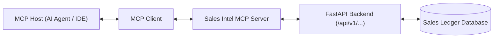

# Sales Intelligence Platform
# Model Context Protocol (MCP) Integration Guide

**Document:** MCP_CONNECTION.md  
**Version:** 2.0  
**Planning Year:** 2026  
**Status:** Architecture Blueprint & Recommended Integration  
**Protocol:** Model Context Protocol (MCP)

---

## 1. Overview & Current Status

Model Context Protocol (MCP) provides an open standard for AI assistants and coding agents to interact with application tools and data sources safely.

- **Current Implementation Status**: The platform exposes high-performance REST APIs via FastAPI (`/api/v1/...`).
- **MCP Compatibility**: External MCP servers can bridge compatible AI agents (such as Antigravity, Claude, or custom LLM hosts) directly into the platform's analytical endpoints.

---

## 2. MCP Server Architecture Blueprint

---

## 3. Recommended Exposed MCP Tools

When deploying an MCP wrapper around the platform, the following tools should be exposed:

1. **`get_sales_overview`**:
   - Description: Retrieves store-wide revenue, active SKU count, and model accuracy.
   - Maps to: `GET /api/v1/analytics/overview`.
2. **`analyze_forecast`**:
   - Description: Executes empirical ledger analysis or walk-forward forecasting for a target product and date horizon.
   - Parameters: `target_name`, `mode`, `selected_date`, `start_date`, `end_date`, `model_preference`.
   - Maps to: `POST /api/v1/ml/analyze`.
3. **`generate_professional_sales_report`**:
   - Description: Generates audited category and sub-category commercial sales performance summary.
   - Maps to: `POST /api/v1/analytics/report`.
4. **`detect_sales_anomalies`**:
   - Description: Scans for rolling Z-score anomalies in units sold.
   - Maps to: `GET /api/v1/analytics/anomalies`.

---

## 4. Security & Access Boundaries

- MCP servers must authenticate to the FastAPI backend using standard JWT Bearer tokens.
- Agents must operate under the least-privilege principle, preventing destructive endpoints (`POST /api/v1/data/reset`) from being triggered autonomously.

---

**End of Model Context Protocol (MCP) Integration Guide**
