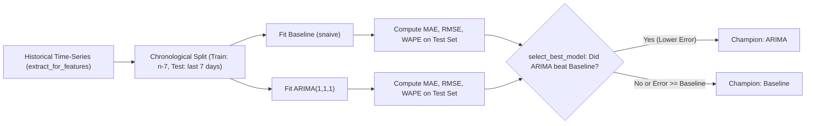

# Sales Intelligence Platform
# Forecasting & Machine Learning Models Specification

**Document:** MODELS.md  
**Version:** 2.0  
**Planning Year:** 2026  
**Status:** Verified & Synchronized Specification  
**Engines:** Statsmodels (ARIMA), Scikit-Learn, NumPy, Pandas  
**Evaluation Strategy:** Chronological Walk-Forward Rolling Cross-Validation

---

## 1. Overview & Modeling Philosophy

The forecasting subsystem provides explainable, reproducible demand forecasts grounded in historical transactional ledgers.

### Core Modeling Principles
1. **Never Predict When You Can Verify**: If the user's selected date or date range falls within the recorded historical dataset coverage, the system extracts verified empirical actuals (units, revenue, week-over-week deltas) rather than running speculative predictions.
2. **Strict Chronological Splitting**: Training and validation sets are split strictly along the time dimension to eliminate future-to-past data leakage.
3. **Conservative Model Selection**: Advanced models (e.g. ARIMA) are chosen over the Seasonal Naive baseline **only** when they achieve lower out-of-sample error during walk-forward validation.
4. **Transparent Uncertainty**: Point estimates are accompanied by prediction intervals (80% and 95% bounds).

---

## 2. Model Inventory

### 2.1 Seasonal Naive (`snaive`) Baseline
Implemented in [`backend/app/ml/baseline.py`](file:///c:/Users/EMAAN/OneDrive/Documents/GitHub/sales-prediction-dashboards/backend/app/ml/baseline.py).
- **Mechanism**: Memorizes the last \(w = 7\) observed daily sales values (capturing weekly seasonality) and projects them into the future:
  \[
  \hat{y}_{t+h} = y_{t+h - w \cdot k}
  \]
  where \(k = \lfloor (h - 1)/w \rfloor + 1\).
- **Minimum Data Requirement**: 7 daily historical observations.
- **Strengths**: Robust to non-stationary spikes, requires zero hyperparameter tuning, strong baseline for retail demand.

### 2.2 Simple Moving Average (`sma`) Baseline
Implemented in [`backend/app/ml/baseline.py`](file:///c:/Users/EMAAN/OneDrive/Documents/GitHub/sales-prediction-dashboards/backend/app/ml/baseline.py).
- **Mechanism**: Averages the last \(w\) days of sales:
  \[
  \hat{y}_{t+h} = \frac{1}{w} \sum_{i=0}^{w-1} y_{t-i}
  \]
- **Use Case**: Smooths out high-frequency noise when seasonal cycles are absent.

### 2.3 Auto-Regressive Integrated Moving Average (`ARIMA`)
Implemented in [`backend/app/ml/training.py`](file:///c:/Users/EMAAN/OneDrive/Documents/GitHub/sales-prediction-dashboards/backend/app/ml/training.py).
- **Mechanism**: Utilizes `statsmodels.tsa.arima.model.ARIMA` configured with order \((p=1, d=1, q=1)\):
  \[
  (1 - \phi_1 B)(1 - B) y_t = c + (1 + \theta_1 B) \epsilon_t
  \]
- **Minimum Data Requirement**: 30 daily continuous observations. If \(n < 30\), the pipeline automatically returns `None` and falls back to `BaselineModel`.
- **Forecast Generation**: Called via `model.forecast(steps=steps)` in [`backend/app/api/v1/endpoints/ml.py:predict_future_steps`](file:///c:/Users/EMAAN/OneDrive/Documents/GitHub/sales-prediction-dashboards/backend/app/api/v1/endpoints/ml.py).

---

## 3. Walk-Forward Cross-Validation & Model Selection

Implemented in [`backend/app/ml/selection.py`](file:///c:/Users/EMAAN/OneDrive/Documents/GitHub/sales-prediction-dashboards/backend/app/ml/selection.py) and [`backend/app/api/v1/endpoints/ml.py:train_and_select_models`](file:///c:/Users/EMAAN/OneDrive/Documents/GitHub/sales-prediction-dashboards/backend/app/api/v1/endpoints/ml.py).



### Selection Algorithm
```python
def select_best_model(eval_results: dict, metric='mae'):
    best_model = None
    best_score = float('inf')
    for model_name, metrics in eval_results.items():
        if metrics[metric] < best_score:
            best_score = metrics[metric]
            best_model = model_name
            
    # Baseline fallback: Reject complex models that do not strictly outperform the baseline
    if best_model != 'baseline' and 'baseline' in eval_results:
        baseline_score = eval_results['baseline'][metric]
        if best_score >= baseline_score:
            return 'baseline'
            
    return best_model
```

---

## 4. Evaluation Metrics & Math Formulations

Implemented in [`backend/app/ml/evaluation.py`](file:///c:/Users/EMAAN/OneDrive/Documents/GitHub/sales-prediction-dashboards/backend/app/ml/evaluation.py).

### 4.1 Mean Absolute Error (MAE)
\[
\text{MAE} = \frac{1}{n} \sum_{t=1}^{n} |y_t - \hat{y}_t|
\]
Measures average magnitude of forecast errors in unit quantities.

### 4.2 Root Mean Squared Error (RMSE)
\[
\text{RMSE} = \sqrt{\frac{1}{n} \sum_{t=1}^{n} (y_t - \hat{y}_t)^2}
\]
Penalizes large outlier forecast errors more heavily than small deviations.

### 4.3 Weighted Absolute Percentage Error (WAPE)
\[
\text{WAPE} = \frac{\sum_{t=1}^{n} |y_t - \hat{y}_t|}{\sum_{t=1}^{n} y_t}
\]
Preferred over MAPE for sales data because it avoids division-by-zero on days with zero sales.

### 4.4 Forecast Bias
\[
\text{Bias} = \frac{\sum_{t=1}^{n} (\hat{y}_t - y_t)}{\sum_{t=1}^{n} y_t}
\]
Detects systematic overprediction (\(\text{Bias} > 0\)) or underprediction (\(\text{Bias} < 0\)).

---

## 5. Forecast Horizon & Time Resolution

- **Primary Frequency**: Daily (`D`).
- **Standard Horizons**:
  - `7d`: 1-week operational replenishment.
  - `14d`: 2-week inventory cycle.
  - `30d`: Monthly commercial demand planning.
- **Handling Incomplete Days**: The latest recorded calendar date is used as the anchor point \(t_0\). Forecast horizons project forward starting at \(t_0 + 1\).

---

## 6. Anomaly & Outlier Detection Engine

Implemented in [`backend/app/ml/anomaly.py`](file:///c:/Users/EMAAN/OneDrive/Documents/GitHub/sales-prediction-dashboards/backend/app/ml/anomaly.py).

```python
def detect_anomalies(df: pd.DataFrame, target_col='units_sold', threshold=2.0) -> pd.DataFrame:
    mean = df[target_col].mean()
    std = df[target_col].std()
    df['z_score'] = (df[target_col] - mean) / (std + 1e-9)
    df['is_anomaly'] = df['z_score'].abs() >= threshold
    # Severity classification:
    # High: |z| >= 3.0, Medium: |z| >= 2.0, Low: |z| >= 1.5
```

---

## 7. Distinguishing Historical Actuals from Future Projections

In the UI ([`frontend/app/forecast/page.tsx`](file:///c:/Users/EMAAN/OneDrive/Documents/GitHub/sales-prediction-dashboards/frontend/app/forecast/page.tsx)) and API response:
- If target date \(\le \text{max\_ledger\_date}\):
  - `is_forecast: false`
  - `status: "HISTORICAL ACTUALS"`
  - Chart series: Rendered on the green solid actuals line (`#10B981`).
- If target date \(> \text{max\_ledger\_date}\):
  - `is_forecast: true`
  - `status: "PROJECTED DEMAND"`
  - Chart series: Rendered on the blue dashed trajectory line (`#3B82F6`) enclosed by the confidence interval.

---

**End of Forecasting & Machine Learning Models Specification**

