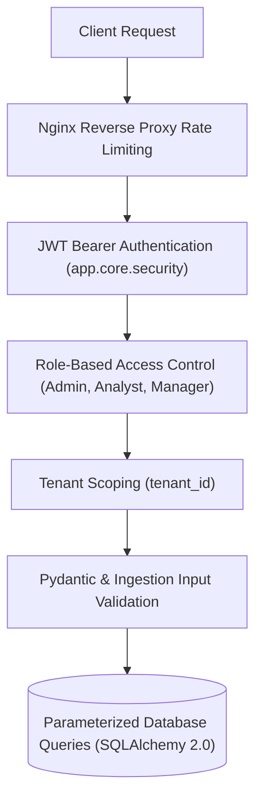

# Sales Intelligence Platform
# Security & Authentication Specification

**Document:** SECURITY.md (and AUTHENTICATION_AND_SECURITY.md)  
**Version:** 2.0  
**Planning Year:** 2026  
**Status:** Verified & Synchronized Specification  
**Mechanisms:** JWT Bearer (python-jose), Bcrypt Password Hashing, Multi-Tenant Isolation

---

## 1. Security Architecture Overview

The platform implements multi-layer defense-in-depth across authentication, authorization, data validation, and tenant isolation:



---

## 2. Authentication Standard (JWT Bearer)

Implemented in [`backend/app/core/security.py`](file:///c:/Users/EMAAN/OneDrive/Documents/GitHub/sales-prediction-dashboards/backend/app/core/security.py) and [`backend/app/api/v1/endpoints/auth.py`](file:///c:/Users/EMAAN/OneDrive/Documents/GitHub/sales-prediction-dashboards/backend/app/api/v1/endpoints/auth.py).

### 2.1 Password Hashing
- Utilizes `passlib.context.CryptContext` with the `bcrypt` algorithm.
- Plaintext passwords are never stored, logged, or serialized into API responses.
- Verification uses `pwd_context.verify(plain_password, hashed_password)`.

### 2.2 Token Minting & Validation
- Tokens are generated using `jose.jwt.encode`.
- Payload standard:
  ```json
  {
    "sub": "user@example.com",
    "role": "ANALYST",
    "tenant_id": "tenant-uuid-1234",
    "exp": 1774300000
  }
  ```
- Expiration: Configurable via `ACCESS_TOKEN_EXPIRE_MINUTES` (default 60 minutes).

---

## 3. Role-Based Access Control (RBAC)

The system defines three standard user roles:

| Role | Access Level & Permissions |
| :--- | :--- |
| **`ADMIN`** | Full platform management, tenant configuration, user provisioning, database resets. |
| **`ANALYST`** | Data ingestion, forecast execution, walk-forward analysis, export downloads. |
| **`MANAGER`** | Read-only executive dashboard inspection and report exports. |

Protected endpoints enforce authorization via FastAPI dependencies (`get_current_user` in [`backend/app/api/deps.py`](file:///c:/Users/EMAAN/OneDrive/Documents/GitHub/sales-prediction-dashboards/backend/app/api/deps.py)).

---

## 4. Multi-Tenant Data Isolation

- Models supporting multi-tenancy include an indexed `tenant_id` foreign key.
- Database queries scope results by the authenticated user's `tenant_id` to prevent cross-organization data leakage.

---

## 5. Input Validation & File Upload Security

- **Path Traversal Mitigation**: Uploaded CSV files are saved with randomized UUID prefixes:
  ```python
  import uuid
  safe_name = f"{uuid.uuid4().hex}_{os.path.basename(file.filename)}"
  file_path = f"uploads/{safe_name}"
  ```
- **File Type Enforcement**: Only `.csv` extensions with verified tabular structure are accepted.
- **SQL Injection Prevention**: All database interactions use SQLAlchemy 2.0 parameterized queries; raw unsanitized SQL string interpolation is strictly prohibited.
- **CORS Protection**: Access is restricted to trusted origins defined in `CORS_ORIGINS`.

---

**End of Security & Authentication Specification**
