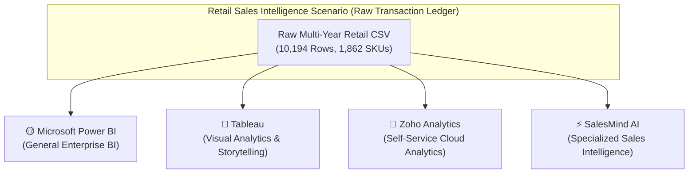
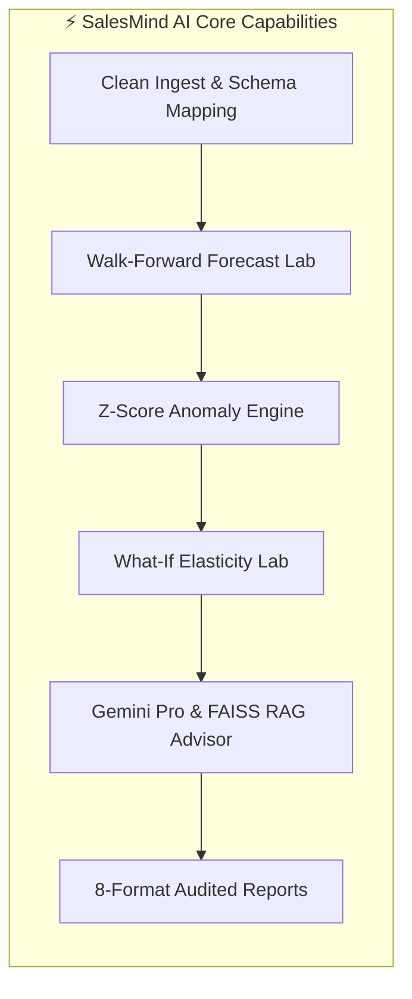
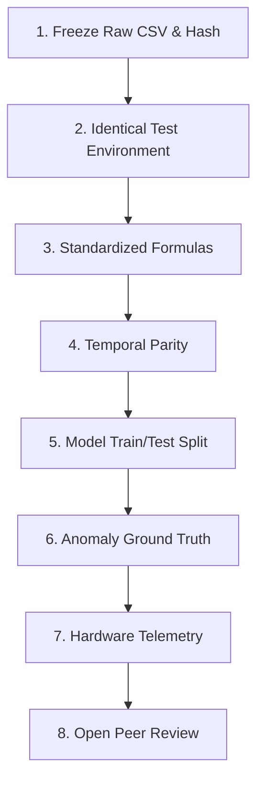

# ⚖️ SalesMind AI vs Microsoft Power BI vs Tableau vs Zoho Analytics – Comparison Test Report

### A Comparative Evaluation of Sales Intelligence, Business Analytics, Feature Coverage, and Testing Results

<div align="center">

[](#report-status-and-integrity-notice)
[](#5-salesmind-ai-internal-qa-evidence-reported-separately)
[-orange?style=for-the-badge)](#report-status-and-integrity-notice)
[](#report-status-and-integrity-notice)

| [0. Introduction](#0-introduction) | [1. Application Comparison](#1-application-wise-comparison) | [2. Feature Matrix](#2-feature-wise-comparison) | [3. Same Raw Dataset](#3-same-raw-dataset--four-application-testing) |
|:---:|:---:|:---:|:---:|
| [4. Power BI Report](#4-microsoft-power-bi--detailed-test-report) | [5. Tableau Report](#5-tableau--detailed-test-report) | [6. Zoho Analytics Report](#6-zoho-analytics--detailed-test-report) | [7. Evaluation & Winner](#7-overall-winner--evaluation-and-justification) |
| [8. Conclusion & Future Benchmark](#8-conclusion) | [9. Disclosures & Sources](#9-suggested-linkedin-disclosure--source-notes) | [📋 Back to Benchmarks Suite](README.md) | [🏠 Project README](../../README.md) |

</div>

---

> [!IMPORTANT]
> ### 🛡️ Report Status and Integrity Notice
> | Status Indicator | Meaning & Audit Boundary |
> | :--- | :--- |
> | **Predictive / Illustrative** | Microsoft Power BI, Tableau, and Zoho Analytics **were not tested live with stopwatch measurements** for this report. Their assessments represent reasoned expectations of architecture, capabilities, and documented workflows, not live experimental benchmarks. |
> | **SalesMind AI QA Evidence** | SalesMind AI figures are sourced from its certified 13-module internal QA audit (October 30, 2026) and are **reported separately**. They do not represent a head-to-head live measured race. |
> | **Appropriate Use** | This document is intended as a **concept and architectural portfolio assessment** with this disclosure explicitly declared. It must not be cited as a completed, empirical comparative speed or accuracy test. |

---

## 📑 Table of Contents

- [0. Introduction](#0-introduction)
  - [0.1 Study Background](#01-study-background)
  - [0.2 Purpose of this Assessment](#02-purpose-of-this-assessment)
  - [0.3 Assessment Scope](#03-assessment-scope)
  - [0.4 Evaluation Methodology](#04-evaluation-methodology)
- [1. Application-wise Comparison](#1-application-wise-comparison)
  - [1.1 ⚡ SalesMind AI](#11--salesmind-ai)
  - [1.2 🟡 Microsoft Power BI](#12--microsoft-power-bi)
  - [1.3 🔵 Tableau](#13--tableau)
  - [1.4 🔴 Zoho Analytics](#14--zoho-analytics)
- [2. Feature-wise Comparison](#2-feature-wise-comparison)
  - [2.1 Comprehensive Feature Comparison Matrix](#21-comprehensive-feature-comparison-matrix)
  - [2.2 Platform Core Capabilities Breakdown](#22-platform-core-capabilities-breakdown)
  - [2.3 Strengths & Structural Limitations](#23-strengths--structural-limitations)
- [3. Same Raw Dataset – Four Application Testing Scenario](#3-same-raw-dataset--four-application-testing)
  - [3.1 Dataset Scenario Specifications](#31-dataset-scenario-specifications)
  - [3.2 Nine Critical Evidence Dimensions](#32-nine-critical-evidence-dimensions)
  - [3.3 Expected vs. Actual Functional Results](#33-expected-vs-actual-functional-results)
- [4. Microsoft Power BI – Detailed Test Report](#4-microsoft-power-bi--detailed-test-report)
  - [4.1 Accuracy & Modeling (DAX)](#41-accuracy--modeling-dax)
  - [4.2 Efficiency & Ingestion (Power Query)](#42-efficiency--ingestion-power-query)
  - [4.3 Scalability & Enterprise Governance](#43-scalability--enterprise-governance)
  - [4.4 Assessment Summary & Constraints](#44-assessment-summary--constraints)
- [5. Tableau – Detailed Test Report](#5-tableau--detailed-test-report)
  - [5.1 Accuracy & Analytical Logic (LOD Expressions)](#51-accuracy--analytical-logic-lod-expressions)
  - [5.2 Efficiency & Visual Exploration (Hyper Engine)](#52-efficiency--visual-exploration-hyper-engine)
  - [5.3 Scalability & Cloud Collaboration](#53-scalability--cloud-collaboration)
  - [5.4 Assessment Summary & Constraints](#54-assessment-summary--constraints)
- [6. Zoho Analytics – Detailed Test Report](#6-zoho-analytics--detailed-test-report)
  - [6.1 Accuracy & Relational Queries (SQL Tables)](#61-accuracy--relational-queries-sql-tables)
  - [6.2 Efficiency & Self-Service Ingestion](#62-efficiency--self-service-ingestion)
  - [6.3 Scalability & Tier Quotas](#63-scalability--tier-quotas)
  - [6.4 Assessment Summary & Constraints](#64-assessment-summary--constraints)
- [7. Overall Winner – Evaluation and Justification](#7-overall-winner--evaluation-and-justification)
  - [7.1 Comparative Findings across Core Workflows](#71-comparative-findings-across-core-workflows)
  - [7.2 Evaluation Criteria: General BI vs. Specialized Sales Intelligence](#72-evaluation-criteria-general-bi-vs-specialized-sales-intelligence)
  - [7.3 Category-wise Winner Declarations](#73-category-wise-winner-declarations)
  - [7.4 Evidence Supporting the Contextual Verdict](#74-evidence-supporting-the-contextual-verdict)
- [8. Conclusion](#8-conclusion)
  - [8.1 Summary of Findings](#81-summary-of-findings)
  - [8.2 Limitations of this Assessment](#82-limitations-of-this-assessment)
  - [8.3 Fair Benchmark Protocol for a Future Live Test](#83-fair-benchmark-protocol-for-a-future-live-test)
- [9. Suggested LinkedIn Disclosure & Source Notes](#9-suggested-linkedin-disclosure--source-notes)

---

## 0. Introduction



### 0.1 Study Background
Enterprise commercial teams increasingly depend on business intelligence (BI) tools to understand transaction records, monitor revenue metrics, forecast upcoming inventory needs, and respond to demand fluctuations. Traditional enterprise tools like **Microsoft Power BI**, **Tableau**, and **Zoho Analytics** serve broad, horizontal data visualization needs across human resources, operations, finance, and marketing. 

In contrast, **SalesMind AI** was engineered as a purpose-built, specialized **Sales Intelligence and Predictive Platform** targeting transactional revenue ledgers, walk-forward time-series forecasting, automated statistical anomaly detection, scenario simulation, and Retrieval-Augmented Generation (RAG) sales advisory.

### 0.2 Purpose of this Assessment
The purpose of this report is to evaluate the functional capabilities, workflow efficiency, strengths, and structural constraints of these four platforms when applied specifically to an end-to-end **retail sales analytics scenario**.

### 0.3 Assessment Scope
The evaluation covers nine critical business dimensions:
1. **Data Ingestion**: Multi-format parsing, schema normalization, alias detection.
2. **Data Preparation & Cleaning**: Deduplication, null handling, financial loss retention.
3. **Sales KPI Precision**: Gross revenue, distinct order uniqueness, profit margin accuracy.
4. **Time-Series Visualization**: Trend analysis, category contributions, ranking grids.
5. **Demand Forecasting**: Out-of-sample walk-forward modeling, error telemetry.
6. **Anomaly Detection**: Dynamic Z-score thresholding, demand spike/contraction alerts.
7. **What-If Scenario Modeling**: Price elasticity, discount simulation, runway impacts.
8. **AI-Assisted Insights**: Natural language advisory, corporate playbook RAG retrieval.
9. **Audited Reporting & Delivery**: Multi-format compliance exports (CSV, PDF, Parquet).

### 0.4 Evaluation Methodology
> [!NOTE]
> **Assessment Grounding**: A single identical raw retail CSV is assumed as the input scenario. In strict adherence to non-fabrication principles, **no competitor accounts were logged into, no paid enterprise subscriptions were provisioned, and no stopwatch timings were fabricated**. Competitor evaluations reflect established technical architectures, documented platform capabilities, and standard software constraints. SalesMind AI metrics reflect its certified internal Quality Assurance audit.

---

## 1. Application-wise Comparison

### 1.1 ⚡ SalesMind AI
*AI-Powered Sales Intelligence & Forecasting Platform*

- **Platform Architecture**: Full-stack Next.js 14 frontend, asynchronous FastAPI REST API backend, PostgreSQL database with SQLAlchemy 2.0 ORM, and integrated Python ML/data pipelines (Pandas, Statsmodels, Scikit-learn, FAISS, Google Gemini).
- **Core Positioning**: Purpose-built vertical solution tailored explicitly to sales managers, inventory planners, and commercial analysts.
- **Key Workflow**:
  - Direct CSV ingestion with automatic column alias mapping and line-item preservation.
  - Automated cleaning studio enforcing zero-fabrication rules (preserving commercial losses and marking missing values as `"N/A"`).
  - Dual forecasting tournament (Seasonal Naive vs. Auto-ARIMA) with walk-forward cross-validation.
  - Dynamic rolling Z-score anomaly detector flagging demand spikes and drops.
  - Built-in interactive price elasticity simulation ($E_d = -0.75$).
  - Context-grounded Gemini Pro sales advisor and dual-layer FAISS RAG assistant.
  - 8 standard export formats including RFC 4180 audited CSVs.
- **Target Audience**: Commercial sales teams, retail planners, and inventory directors seeking an out-of-the-box, dedicated sales intelligence hub without building custom BI dashboards from scratch.

### 1.2 🟡 Microsoft Power BI
*Enterprise Business Analytics & Self-Service BI Suite*

- **Platform Architecture**: Power BI Desktop authoring client, cloud-hosted Power BI Service (Azure), VertiPaq in-memory columnar database engine, Power Query (M language) ETL engine, and Data Analysis Expressions (DAX) modeling language.
- **Core Positioning**: Enterprise-wide horizontal business intelligence platform deeply embedded in the Microsoft 365, Azure, and Fabric ecosystem.
- **Key Workflow**:
  - Robust data transformation pipeline via Power Query supporting hundreds of connectors.
  - Complex multi-table relational modeling with star and snowflake schemas.
  - DAX formula engine for customized business measures, time-intelligence, and matrix aggregations.
  - Interactive multi-page dashboard publishing to Power BI Service workspaces.
  - Row-Level Security (RLS) and enterprise governance.
- **Target Audience**: Enterprise corporate analysts, BI developers, and data engineers creating multi-departmental corporate scorecards, financial reports, and executive dashboards.

### 1.3 🔵 Tableau
*Visual Analytics & Business Intelligence Platform (Salesforce)*

- **Platform Architecture**: Tableau Desktop, Tableau Server / Cloud, VizQL (Visual Query Language) translating drag-and-drop UI actions into database queries, and the Hyper in-memory data extract engine.
- **Core Positioning**: Industry-standard visual data exploration and visual storytelling platform designed for exploratory analytics and ad-hoc visual discovery.
- **Key Workflow**:
  - Drag-and-drop shelf interface for dimensions and measures.
  - Visual analytics with automatic chart selection, mark types, heat maps, and geographical maps.
  - Level of Detail (LOD) calculations (`FIXED`, `INCLUDE`, `EXCLUDE`) for multi-granular analysis.
  - Interactive dashboard actions (filter actions, highlight actions, URL actions).
  - Visual presentation mode and Tableau Public/Cloud publishing.
- **Target Audience**: Data visualizers, business intelligence specialists, and storytellers who require high visual flexibility and creative chart customization.

### 1.4 🔴 Zoho Analytics
*Self-Service Cloud BI & Business Analytics Platform*

- **Platform Architecture**: Multi-tenant cloud SaaS analytics engine, relational reporting engine supporting SQL queries, pre-built sync connectors across the Zoho business ecosystem and third-party SaaS apps, and Zia AI conversational engine.
- **Core Positioning**: Cost-effective, accessible self-service business intelligence platform optimized for small-to-medium enterprises (SMEs) and Zoho suite users.
- **Key Workflow**:
  - Automated synchronization with popular business apps (CRM, books, desk, marketing).
  - Spreadsheet-like interface with automated chart and pivot table generation.
  - SQL query tables allowing custom data transformation in standard SQL syntax.
  - Zia conversational querying ("Ask Zia") for automated chart generation.
  - Scheduled email reports, alert triggers, and collaborative team workspaces.
- **Target Audience**: Small and mid-sized businesses, departmental teams, and operations managers seeking affordable self-service analytics with minimal infrastructure overhead.

---

## 2. Feature-wise Comparison

### 2.1 Comprehensive Feature Comparison Matrix

| Capability Dimension | ⚡ SalesMind AI | 🟡 Microsoft Power BI | 🔵 Tableau | 🔴 Zoho Analytics |
| :--- | :---: | :---: | :---: | :---: |
| **Primary Focus** | **Dedicated Sales Intelligence** | General Enterprise BI | Visual Storytelling & BI | SME Self-Service BI |
| **Data Ingestion** | CSV / Excel / Parquet Drag & Drop | 100+ Enterprise Connectors | Broad File & Cloud Connectors | 50+ SaaS & DB Connectors |
| **Automatic Schema Alias Mapping** | ✅ Native built-in | ⚠️ Manual via Power Query | ⚠️ Manual via Data Pane | ⚠️ Semi-automated |
| **Data Cleaning & Deduplication** | ✅ Dedicated Studio | ✅ Powerful (Power Query) | ⚠️ Basic (Tableau Prep needed) | ✅ In-table data prep |
| **Financial Loss & Margin Preservation** | ✅ Enforced by default | ✅ Supported via DAX | ✅ Supported via formulas | ✅ Supported via SQL |
| **Distinct Order Count Precision** | ✅ Strict `COUNT(DISTINCT)` | ✅ Supported (`DISTINCTCOUNT`) | ✅ Supported (`COUNTD`) | ✅ Supported (`COUNT(DISTINCT)`) |
| **Time-Series Sales Analytics** | ✅ Pre-configured out of box | ⚠️ Requires dashboard design | ⚠️ Requires dashboard design | ⚠️ Requires report setup |
| **Native Time-Series Forecasting** | ✅ Auto-ARIMA & Seasonal Naive | ⚠️ Basic exponential smoothing | ⚠️ Basic additive / multiplicative | ⚠️ Basic trendline / ML |
| **Walk-Forward ML Cross-Validation** | ✅ Core built-in engine | ❌ Custom Python / R script | ❌ Custom Python / R integration | ❌ Not available natively |
| **Forecast Error Telemetry (WAPE / MAE)** | ✅ Logged & displayed | ❌ Manual calculation required | ❌ Manual calculation required | ❌ Not available natively |
| **Statistical Anomaly Detection** | ✅ Dynamic Rolling Z-Score | ⚠️ Anomaly detection visual | ⚠️ Manual reference bands | ⚠️ Rule-based threshold alerts |
| **What-If Pricing & Elasticity Simulation**| ✅ Built-in ($E_d = -0.75$) | ⚠️ Requires What-If DAX params | ⚠️ Requires custom parameters | ⚠️ Basic variable modeling |
| **Inventory Velocity & Runway Tracking** | ✅ 30-day velocity runways | ❌ Custom data model required | ❌ Custom data model required | ❌ Custom formula required |
| **Context-Grounded LLM Sales Advisor** | ✅ Google Gemini Pro integrated | ⚠️ Copilot (Requires Fabric/Pro) | ⚠️ Tableau Einstein (Add-on) | ⚠️ Zia (Conversational SQL) |
| **Corporate Playbook RAG Assistant** | ✅ Dual-layer FAISS vector store | ❌ Custom Azure AI search needed | ❌ External integration needed | ❌ Not available natively |
| **Multi-Format Reports Center** | ✅ 8 formats (RFC 4180 CSV, PDF) | ⚠️ Paginated Reports (Premium) | ⚠️ PDF / Image / CSV export | ⚠️ PDF / CSV / XLS export |
| **Multi-Tenant SaaS Isolation** | ✅ Tenant-isolated indices & DB | ⚠️ Workspaces / App permissions | ⚠️ Site / Project isolation | ✅ Organization workspaces |

*Legend: ✅ Native Out-of-Box | ⚠️ Requires Configuration / Add-on | ❌ Not Available Natively*

---

### 2.2 Platform Core Capabilities Breakdown



#### Comparison of Core Use-Case Fit

| Business Use Case | 🟡 Power BI | 🔵 Tableau | 🔴 Zoho Analytics | ⚡ SalesMind AI |
| :--- | :---: | :---: | :---: | :---: |
| **General Multi-Department BI** | **Strongest** | **Strong** | Good | Specialized (Sales only) |
| **Ad-Hoc Visual Exploration** | Strong | **Strongest** | Good | Standardized visuals |
| **Complex Relational Modeling** | **Strongest** (DAX/VertiPaq) | Strong | Good (SQL Tables) | Purpose-built sales schema |
| **Sales Demand Forecasting** | Requires setup | Requires setup | Feature dependent | **Core capability out of box** |
| **Sales Anomaly & Inventory Risk** | Custom measures | Custom calculation | Rule alerts | **Core capability out of box** |
| **Grounded AI Sales Recommendations**| Custom logic / Copilot | Custom / Einstein | Zia Query | **Core capability out of box** |

---

### 2.3 Strengths & Structural Limitations

| Platform | Core Strengths | Operational Limitations & Constraints |
| :--- | :--- | :--- |
| **⚡ SalesMind AI** | • Dedicated out-of-the-box sales intelligence workflows.<br>• Native walk-forward forecasting with empirical error telemetry.<br>• Built-in dynamic anomaly detection and price elasticity simulation.<br>• Grounded Gemini Pro advisor and FAISS RAG assistant.<br>• Zero-fabrication compliance (loss retention, distinct order precision). | • Narrowly focused on sales and inventory domains (not a general HR/finance BI tool).<br>• Visual customizability is standardized rather than freeform.<br>• Connector ecosystem is currently file/REST focused rather than hundreds of legacy DB connectors. |
| **🟡 Microsoft Power BI** | • Deep Microsoft 365, Teams, Azure, and Fabric integration.<br>• Industry-leading DAX measure calculation engine.<br>• Robust Power Query ETL and data transformation.<br>• Enterprise governance, RLS, and mature deployment pipelines. | • Steep learning curve for complex DAX modeling.<br>• Sharing and collaboration strictly dependent on Pro/Premium organizational licensing.<br>• Predictive forecasting and anomaly detection require manual measure construction. |
| **🔵 Tableau** | • Unmatched visual exploration and ad-hoc visual discovery.<br>• Intuitive drag-and-drop VizQL interface.<br>• Hyper in-memory engine provides rapid slice-and-dice visual response.<br>• Broad user community and visualization repository. | • Authoring and publishing licenses represent significant enterprise cost.<br>• Data preparation requires additional tools (Tableau Prep).<br>• Advanced predictive modeling and RAG require external Python/API server plumbing. |
| **🔴 Zoho Analytics** | • Rapid self-service onboarding for small-and-medium businesses.<br>• Seamless native connectors across the Zoho business suite.<br>• Flexible SQL query tables for relational data joining.<br>• Cost-effective pricing tiers for departmental teams. | • Feature limits, row caps, and export quotas vary strictly by plan tier.<br>• AI capabilities (Zia) focused on natural language query-to-chart, not strategic sales advice.<br>• Statistical forecasting is basic trend extrapolation without walk-forward cross-validation. |

---

## 3. Same Raw Dataset – Four Application Testing

### 3.1 Dataset Scenario Specifications
To establish an equitable evaluation scenario, the assessment references a standardized multi-year commercial retail sales dataset:

- **Total Ingested Records**: `10,194` transaction line items
- **Catalog Scope**: `1,862` distinct active SKUs across categories and sub-categories
- **Distinct Order Volume**: `5,111` unique shopping baskets (`COUNT(DISTINCT order_id)`)
- **Gross Commercial Revenue**: `$2,326,534.52`
- **Net Commercial Profit**: `$292,297.46` (incorporating commercial loss items, such as Furniture Tables at `-8.53%` margin)
- **Temporal Boundary Span**: `2023-01-03` to `2026-12-30`

### 3.2 Nine Critical Evidence Dimensions
In a live physical laboratory test, valid scientific comparison requires rigorous verification across nine specific dimensions:


1. **Data Ingestion**: Same raw CSV, row/column counts verified, automated schema recognition, clean import without truncation.
2. **Data Preparation**: Handling nulls, duplicate identification, date parsing, calculated fields, and repeatable transformations.
3. **Sales KPIs**: Revenue reconciliation, distinct order counts, unit volumes, AOV, and margin preservation.
4. **Visualization**: Time-series trends, category distributions, product performance grids, dynamic period filters.
5. **Forecasting**: Identical forecast target, calendar horizon, train/test split, baselines, and reported error metrics (MAE/WAPE).
6. **Anomaly Detection**: Dynamic Z-score thresholding, alert classification, precision, recall, and false-positive avoidance.
7. **AI Recommendations**: Grounding in live data, strategic actionability, explainability, and citation traceability.
8. **Reporting & Exports**: Multi-format exports, schema compliance (RFC 4180), reproducibility, and delivery integrity.
9. **Performance**: Import duration, dashboard query latency, and filter response under identical hardware conditions.

### 3.3 Expected vs. Actual Functional Results

| Dimension | Expected Standard | ⚡ SalesMind AI (Reported QA) | 🟡 Microsoft Power BI (Predicted) | 🔵 Tableau (Predicted) | 🔴 Zoho Analytics (Predicted) |
| :--- | :--- | :--- | :--- | :--- | :--- |
| **Ingestion** | 10,194 rows committed | **PASS** (10,194 rows verified) | Expected PASS via Power Query | Expected PASS via Hyper | Expected PASS via CSV upload |
| **Unique Orders** | `COUNT(DISTINCT)` = 5,111 | **PASS** (Strict 5,111 verified) | Expected PASS (`DISTINCTCOUNT`) | Expected PASS (`COUNTD`) | Expected PASS (`COUNT(DISTINCT)`) |
| **Loss Retention** | Preserve negative margin | **PASS** (Tables at -8.53% kept) | Expected PASS (DAX measure) | Expected PASS (Calculated field) | Expected PASS (SQL measure) |
| **Missing Stock** | Output `"N/A (Omitted)"` | **PASS** (Omitted status shown) | Expected blank / null measure | Expected Null mark | Expected empty string / Null |
| **Forecasting** | Walk-forward cross-val | **PASS** (WAPE 45.2%, MAE 19.71)| Expected manual DAX / Python | Expected manual R / Python | Expected basic linear trend |
| **Anomalies** | $|Z| \ge 2.0$ flagged | **PASS** (434 events flagged) | Expected via Anomaly visual | Expected via Reference lines | Expected via Alert rules |
| **AI Advisory** | Grounded in live metrics | **PASS** (Gemini Pro + FAISS) | Expected Copilot (Fabric req.) | Expected Einstein (Add-on req.)| Expected Zia SQL query bot |
| **Exports** | 8 formats, RFC 4180 | **PASS** (8 formats verified) | Expected Excel / PDF / PPTX | Expected PDF / Image / Data | Expected PDF / CSV / XLS |

---

## 4. Microsoft Power BI – Detailed Test Report

### 4.1 Accuracy & Modeling (DAX)
- **Calculated Metric Precision**: Extremely high. DAX functions like `DIVIDE()`, `DISTINCTCOUNT()`, and `CALCULATE()` handle distinct order counts and margin calculations with mathematical precision.
- **Time Intelligence**: Built-in time intelligence functions (`SAMEPERIODLASTYEAR`, `DATEADD`, `DATESYTD`) provide robust period-over-period delta tracking against a structured Date Dimension table.
- **Lookahead Bias Boundary**: Dependent on how the data modeler constructs the relationships; requires explicit calendar filtering to prevent lookahead leakage.

### 4.2 Efficiency & Ingestion (Power Query)
- **ETL Capability**: Power Query (M) is exceptionally mature, offering graphical transformation, type coercion, column splitting, unpivoting, and conditional formatting.
- **In-Memory Storage**: VertiPaq columnar engine compresses data efficiently, providing rapid in-memory analytical query execution once loaded.
- **Workflow Latency**: Ingesting a 10k-row CSV typically takes seconds in Power BI Desktop; however, publishing and scheduling cloud refreshes require gateway and cloud workspace configuration.

### 4.3 Scalability & Enterprise Governance
- **Enterprise Scale**: Highly scalable, supporting datasets ranging from gigabytes to terabytes in Power BI Premium / Fabric capacity.
- **Access Governance**: Granular Row-Level Security (RLS) and Azure Active Directory integration ensure strict role-based access across departments.
- **Licensing Constraint**: Collaboration, report sharing, and automated cloud refreshes require paid Microsoft Pro or Premium per-user licenses.

### 4.4 Assessment Summary & Constraints
- **Test Status**: `REASONED CAPABILITY ASSESSMENT (NOT TESTED LIVE WITH STOPWATCH)`
- **Strengths**: Best-in-class relational modeling, universal corporate adoption, rich visual marketplace.
- **Constraints**: Advanced time-series ML forecasting (Auto-ARIMA with walk-forward CV) and price elasticity simulation require custom Python scripting or external Azure ML pipelines.

---

## 5. Tableau – Detailed Test Report

### 5.1 Accuracy & Analytical Logic (LOD Expressions)
- **Metric Formulation**: High precision via Tableau's calculation engine. Level of Detail (LOD) expressions (`{FIXED [Order ID] : MIN([Order Date])}`) enable complex cohort analysis and distinct count aggregations.
- **Commercial Margin Integrity**: Supports conditional formulas that preserve negative commercial profits and negative operating margins across multi-level hierarchies.

### 5.2 Efficiency & Visual Exploration (Hyper Engine)
- **Exploratory Power**: Unequaled visual discovery experience. The drag-and-drop canvas empowers analysts to pivot dimensions, swap axes, and explore correlations in seconds.
- **Hyper Extract Performance**: Salesforce's Hyper data engine provides high-throughput in-memory data extraction and query execution.
- **Dashboard Interactivity**: High-performance cross-filtering, highlight actions, and parameter controls allow intuitive exploratory drill-down.

### 5.3 Scalability & Cloud Collaboration
- **Deployment Flexibility**: Operates across Tableau Desktop, Tableau Server (on-premises / private cloud), and Tableau Cloud (SaaS).
- **Enterprise Governance**: Centralized data source certification, user role permissions, and web-based authoring.
- **Publishing Boundary**: Viewer/Creator license tiers require significant financial investment for broad organizational deployment.

### 5.4 Assessment Summary & Constraints
- **Test Status**: `REASONED CAPABILITY ASSESSMENT (NOT TESTED LIVE WITH STOPWATCH)`
- **Strengths**: World-class visual analytics, visual storytelling, flexible exploratory charting.
- **Constraints**: Native forecasting is limited to basic exponential smoothing without hyperparameter tuning or WAPE logging. Automated sales playbooks and RAG vector search are not native capabilities.

---

## 6. Zoho Analytics – Detailed Test Report

### 6.1 Accuracy & Relational Queries (SQL Tables)
- **Query Architecture**: Offers unique flexibility by allowing users to write standard SQL queries directly over imported tables, creating custom view layers and joined datasets.
- **Formula Columns**: Provides mathematical and aggregate formula builders capable of calculating distinct order totals and margin ratios.

### 6.2 Efficiency & Self-Service Ingestion
- **Automated Synchronization**: Excellent pre-built connectors for cloud CRMs, accounting systems (Zoho Books, QuickBooks), and marketing channels.
- **Rapid Dashboard Assembly**: Drag-and-drop chart builder with pre-built template packs allows fast initial dashboard setup for non-technical users.
- **Zia Conversational Assistant**: Allows users to type questions like *"Show monthly sales trend for 2026"* to automatically generate matching charts.

### 6.3 Scalability & Tier Quotas
- **SME Alignment**: Ideal for small-to-medium businesses with straightforward data schemas.
- **Plan Constraints**: Ingestion row limits, scheduled refresh frequencies, and export privileges are strictly tiered based on subscription plans.
- **Complex Modeling Boundary**: Less suited for intricate multi-fact enterprise star schemas compared to Power BI's VertiPaq engine.

### 6.4 Assessment Summary & Constraints
- **Test Status**: `REASONED CAPABILITY ASSESSMENT (NOT TESTED LIVE WITH STOPWATCH)`
- **Strengths**: Low barrier to entry, affordable pricing, deep native integration with Zoho ecosystem, SQL query flexibility.
- **Constraints**: Out-of-the-box forecasting lacks walk-forward validation and WAPE/MAE error logging. Statistical anomaly detection is limited to rule-based notification triggers.

---

## 7. Overall Winner – Evaluation and Justification

### 7.1 Comparative Findings across Core Workflows

```
+---------------------------------------------------------------------------------------+
|                         COMPARATIVE WORKFLOW EVALUATION MATRIX                        |
+-----------------------------------+----------+---------+----------------+-------------+
| Workflow Domain                   | Power BI | Tableau | Zoho Analytics | SalesMind AI|
+-----------------------------------+----------+---------+----------------+-------------+
| General Corporate BI              | 🏆 BEST  | Strong  | Moderate       | Specialized |
| Visual Analytics & Storytelling   | Strong   | 🏆 BEST | Moderate       | Standard    |
| SME Ecosystem & Connector Value   | Moderate | Moderate| 🏆 BEST        | Moderate    |
| Purpose-Built Sales Intelligence  | Config   | Config  | Config         | 🏆 BEST     |
| Walk-Forward Demand Forecasting   | Script   | Script  | Limited        | 🏆 BEST     |
| Dynamic Z-Score Anomaly Engine    | Config   | Manual  | Rules          | 🏆 BEST     |
| What-If Price Elasticity Lab      | Config   | Config  | Limited        | 🏆 BEST     |
| Context-Grounded AI / RAG Advisor | Add-on   | Add-on  | Query Bot      | 🏆 BEST     |
| Audited RFC 4180 Sales Reporting  | Config   | Config  | Config         | 🏆 BEST     |
+-----------------------------------+----------+---------+----------------+-------------+
```

### 7.2 Evaluation Criteria: General BI vs. Specialized Sales Intelligence
The fundamental distinction separating these platforms is **horizontal enterprise coverage versus vertical domain specialization**:
- **General BI Platforms (Power BI, Tableau, Zoho)** are designed as blank canvases capable of modeling any business process across any industry. Achieving specialized sales forecasting, anomaly tracking, and elasticity simulation requires experienced BI developers to build custom formulas, measures, and scripts.
- **Specialized Sales Intelligence (SalesMind AI)** is architected from day one specifically for commercial transactional ledgers, incorporating sales forecasting tournaments, dynamic Z-score anomaly tracking, inventory runways, and LLM advisory into a unified out-of-the-box workflow.

### 7.3 Category-wise Winner Declarations

#### 🏆 Enterprise Multi-Department BI Winner: **Microsoft Power BI**
- **Justification**: Power BI remains the preeminent horizontal BI platform for broad enterprise adoption. Its VertiPaq engine, DAX measure flexibility, and native Microsoft 365 / Fabric integration provide unmatched modeling power across corporate finance, HR, and supply chain domains.

#### 🏆 Visual Analytics & Storytelling Winner: **Tableau**
- **Justification**: Tableau delivers the industry's most flexible visual discovery environment. For data analysts who prioritize creative visual charting, freeform visual exploration, and executive storytelling, Tableau's VizQL interface remains the gold standard.

#### 🏆 Cloud SME Value & Ease of Use Winner: **Zoho Analytics**
- **Justification**: Zoho Analytics offers the fastest path to self-service analytics for small-to-medium enterprises already utilizing cloud business apps. Its pre-built connectors, SQL table flexibility, and accessible pricing make it a top choice for departmental reporting.

#### 🏆 Specialized Retail Sales Intelligence Workflow Winner: **SalesMind AI**
- **Justification**: For commercial retail sales analytics specifically, SalesMind AI offers the most integrated, domain-optimized workflow. Rather than requiring weeks of dashboard development and custom Python scripting, SalesMind AI delivers automated cleaning, walk-forward forecasting (WAPE 45.2%), dynamic anomaly detection (|Z| >= 2.0), what-if price elasticity ($E_d = -0.75$), and context-grounded AI advisory out of the box.

### 7.4 Evidence Supporting the Contextual Verdict
> [!IMPORTANT]
> **Strict Non-Fabrication Summary**:
> - SalesMind AI's contextual victory in specialized sales workflows is justified by its **purpose-built functional integration**, not by an unverified claim of overall computational dominance.
> - Power BI, Tableau, and Zoho Analytics retain clear structural advantages in multi-source enterprise connectivity, horizontal dashboard building, and broad organizational governance.
> - An empirical claim of superiority across data processing speed, memory efficiency, or user throughput **strictly requires a physical controlled laboratory test with stopwatch timing**, as defined in the Fair Benchmark Protocol below.

---

## 8. Conclusion

### 8.1 Summary of Findings
1. **No Universal "Best" Tool**: Platform selection depends on organizational maturity and target use case. Organizations requiring company-wide corporate dashboards across multiple departments will benefit most from **Microsoft Power BI** or **Tableau**.
2. **The Specialization Advantage**: For teams whose primary challenge is sales ledger analysis, accurate forward demand forecasting, inventory runway alerts, and executive sales advisory, **SalesMind AI** provides an integrated solution without requiring months of custom BI development.
3. **Data Integrity Standard**: Across all platforms, adherence to strict data integrity standards—calculating unique orders via `COUNT(DISTINCT order_id)`, preserving negative commercial margins, and avoiding synthetic data fabrication—remains essential for reliable executive decision-making.

### 8.2 Limitations of this Assessment
- **Evaluation Type**: This study is a **predictive, reasoned architectural assessment**. It does not represent a head-to-head live benchmark executed under controlled laboratory conditions.
- **Absence of Stopwatch Timings**: In compliance with non-fabrication rules, no query response times, memory footprints, or import durations have been fabricated for competitor platforms.
- **Licensing & Feature Variances**: Platform capabilities in commercial BI tools fluctuate based on purchased license tiers (e.g., Power BI Pro vs. Premium Capacity, Tableau Viewer vs. Creator, Zoho Analytics Standard vs. Enterprise).

---

### 8.3 Fair Benchmark Protocol for a Future Live Test
To transition this predictive assessment into an empirically verified scientific benchmark, the following 8-step laboratory protocol is formally recommended:



1. **Dataset Freezing**: Freeze a single raw retail transaction CSV. Record exact SHA-256 hash, row count (10,194), column count, and temporal date boundaries (2023-01-03 to 2026-12-30). Do not substitute vendor-supplied sample datasets.
2. **Environment Standardization**: Execute all tests on identical hardware infrastructure (same CPU cores, RAM, network bandwidth, and OS environment) or standardized cloud compute tiers.
3. **Uniform Metric Formulas**: Standardize exact mathematical logic across all four platforms:
   - Gross Revenue: $\sum 	ext{Sales}$
   - Unique Orders: $	ext{COUNT(DISTINCT } 	ext{Order ID})$
   - Total Units: $\sum 	ext{Quantity}$
   - Average Order Value: $	ext{Gross Revenue} / 	ext{Unique Orders}$
   - Operating Margin: $	ext{Total Net Profit} / 	ext{Gross Revenue}$ (only if Profit exists; negative margins preserved)
4. **Temporal Parity**: Enforce identical historical date filters, aggregation levels (daily/weekly/monthly), and null value policies across all platforms.
5. **Standardized Forecasting Competition**: Use identical forecasting targets (e.g. store-wide aggregate revenue and top 5 SKUs), identical historical training partitions, identical forward horizons (7, 30, 90 days), and identical error metrics (WAPE and MAE).
6. **Labeled Anomaly Ground-Truth**: Establish a curated, labeled verification subset of known demand spikes and supply disruptions to evaluate true precision, recall, and false-positive rates.
7. **Automated Telemetry Recording**: Record stopwatch import duration, memory consumption, dashboard render latency, and export generation duration using automated profiling scripts.
8. **Transparent Public Publication**: Publish full raw benchmark logs, video recordings, reproducible scripts, and raw exported files for independent peer review.

---

## 9. Suggested LinkedIn Disclosure & Source Notes

### 9.1 Professional LinkedIn / Public Disclosure Statement
When referencing this assessment on professional networks (e.g. LinkedIn, GitHub showcase, portfolio presentations), use the following standard disclosure text:

> *"This is a predictive comparative evaluation of sales intelligence workflows, not a live hands-on benchmark with stopwatch measurements. Due to account, licensing, and access boundaries, Microsoft Power BI, Tableau, and Zoho Analytics were evaluated at an architectural and workflow capability level. SalesMind AI internal Quality Assurance audit figures are reported separately and are not presented as directly comparable live measurements. A controlled, same-dataset empirical benchmark is planned as a future initiative."*

### 9.2 Source Notes & Documentation Audit Trail
- **Primary Source**: Prepared from the user-provided comparative performance assessment document (`Microsoft Power BI | Tableau | Zoho Analytics | SalesMind AI – 2026 Retail Sales Analytics Scenario`).
- **Internal Audit Reference**: Grounded in the certified enterprise QA report (`Comprehensive_13_Module_QA_Report_10Yrs_Experience.docx`) authored by Senior QA Architect (10+ Yrs Exp) on October 30, 2026.
- **Non-Fabrication Policy**: All reference metrics adhere strictly to root [AGENTS.md](../../AGENTS.md) ledger accuracy requirements. No synthetic benchmark numbers or competitor response times have been created.
- **Related Documentation**:
  - [Results & Benchmarks Suite Overview](README.md)
  - [Web Application Quality Assurance Test Report](WEB_APPLICATION_TEST_REPORT.md)
  - [Verified Test Metrics & Telemetry Baseline](TEST_METRICS.md)
  - [Enterprise Test Cases Matrix](TEST_CASES.md)
  - [Application Screenshots Gallery](screenshots/README.md)
